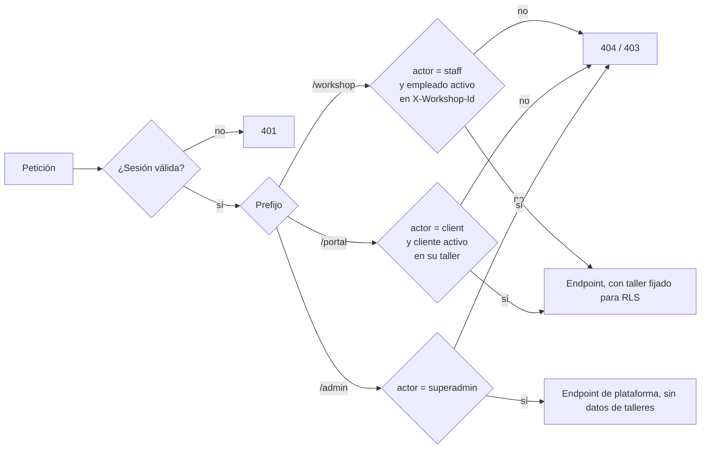
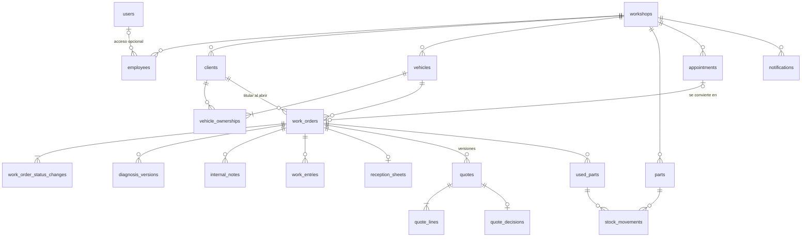
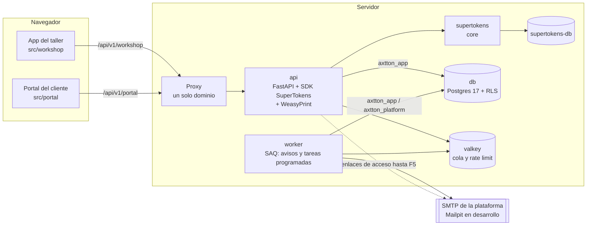
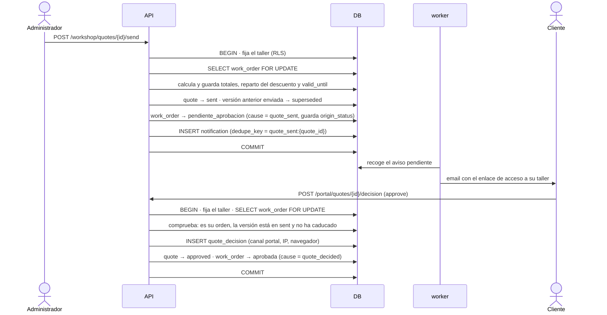
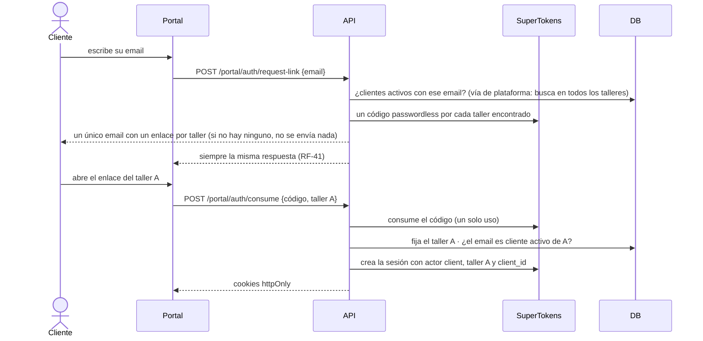
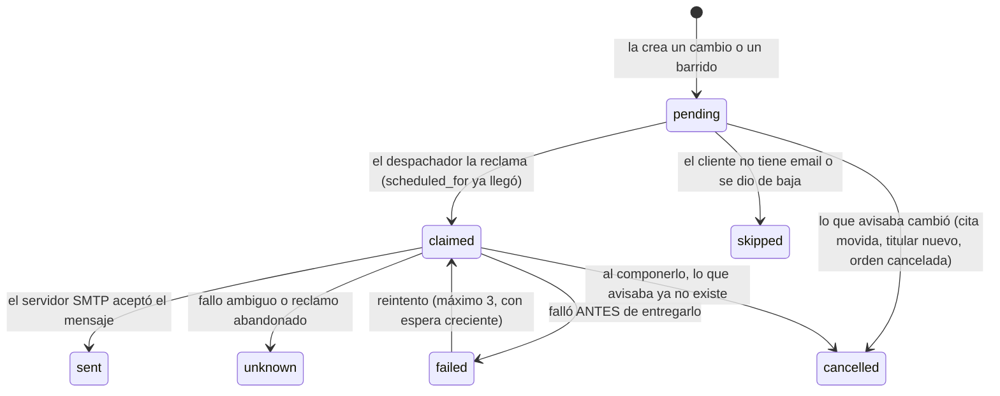

# Arquitectura

> Estado: **v0.1 completa** (2026-10-23) · sin código todavía. Todas las secciones están escritas; se revisa con el usuario antes de empezar F0.

Este documento recoge **qué se ha decidido y contra qué alternativa**. La especificación de producto está en [producto/especificacion.md](../producto/especificacion.md); los requisitos se citan por su número (RF-xx, RNF-xx).

## 1. Decisiones

| # | Decisión | Elección | Alternativa descartada y por qué |
|---|---|---|---|
| A1 | Backend | **FastAPI + SQLAlchemy async + Alembic**, Python con uv, monolito en capas. Heredado de Applications Tracker | **Cambiar de framework** (Django, NestJS): no hay un requisito que lo pida, y se perderían las convenciones y las trampas ya documentadas. **Microservicios**: un taller no tiene la escala ni el equipo que los justifiquen. |
| A2 | Base de datos | **PostgreSQL 17**, una sola base para la aplicación | Ninguna seria: Postgres además da RLS (A7). |
| A3 | Frontend | **Un proyecto Vite con dos aplicaciones**: `src/workshop/` y `src/portal/`, con lo común en `src/shared/`. React 19 + TS, TanStack Query, react-hook-form + zod, Tailwind v4 + shadcn/ui, i18next. Cada aplicación es una entrada de Vite con su propio paquete | **Una sola SPA con dos árboles de rutas**: el cliente descargaría el código del taller y compartirían estado global. **Dos proyectos**: doble mantenimiento de dependencias y componentes para la misma interfaz. |
| A4 | Autenticación | **SuperTokens para los tres actores**: email y contraseña (receta `emailpassword`) para el personal y el superadministrador; enlace mágico (receta `passwordless`) para los clientes. Detalle en §2 | **Zitadel**: OIDC estándar, passkeys y MFA gratis y consola de identidades, pero **no tiene enlace mágico**: el portal necesitaría un sistema de sesión propio aparte, y en el navegador exige que el backend haga de intermediario para no exponer tokens; además pesa más en infraestructura. Gana en lo que aquí está pospuesto. **Revisar esta decisión si** las apps móviles pasan a ser una fase real, el 2FA pasa a ser obligatorio o un taller quiere entrar con la cuenta de su empresa (SSO). **Híbrido** (SuperTokens para el personal, sesión propia para el portal): dos sistemas de sesión que mantener. **Autenticación propia**: habría que escribir y probar uno mismo la rotación, la revocación y el CSRF. |
| A5 | Separación de actores en la API | **Tres prefijos**: `/api/v1/workshop/*`, `/api/v1/portal/*` y `/api/v1/admin/*`. Cada uno tiene una dependencia **a nivel de router** que exige su actor y rechaza cualquier otro | **Comprobar el actor en cada endpoint**: basta con olvidarlo una vez. Con el router, un endpoint nuevo queda protegido por construcción. |
| A6 | Taller activo | **Llega en cada petición** del personal (cabecera `X-Workshop-Id`) y se valida contra los empleados activos del usuario (RNF-09) | **Guardarlo en la sesión**: cambiar de taller obligaría a renovar la sesión, y dos pestañas no podrían trabajar en talleres distintos. |
| A7 | Aislamiento entre talleres | **Dos capas en la base de datos además del filtro de la aplicación**: claves foráneas compuestas `(workshop_id, id)`, que impiden enlazar datos de dos talleres, y **Row-Level Security**, que impide leer o escribir filas de otro taller aunque una consulta olvide filtrar | **Solo FK compuestas** (como Applications Tracker): un filtro olvidado devolvería datos de otro taller, y solo lo cazarían las pruebas. Con varios talleres, ese error es el más probable y el más grave. |
| A8 | Trabajo en segundo plano | **Valkey + SAQ** con un servicio `worker`, también para los trabajos programados (recordatorios, vencimientos, caducidad de presupuestos, borrado de firmas). Heredado | **Celery**: más pesado para el mismo uso. **cron del sistema**: fuera de Docker, sin reintentos ni registro. |
| A9 | Documentos | **PDF generados con WeasyPrint + Jinja2**. Heredado. **Sin almacén de ficheros**: no hay ficheros subidos (RF-50), y la firma en pantalla se guarda como dato en la base de datos | **Un almacén de ficheros "por si acaso"**: un servicio, un volumen y unas copias de seguridad para nada. Añadirlo después no obliga a rehacer nada (especificación §12). |
| A10 | Correo | **SMTP de la plataforma** para todo (RF-68); **Mailpit** en desarrollo. Heredado | **SMTP por taller**: descartado en la especificación (R12). |
| A11 | Borradores sin conexión | **IndexedDB en el navegador** para lo que se está escribiendo (RNF-22), con aviso de conflicto al enviar (RNF-15) | **Funcionar sin conexión de verdad**: sincronización y resolución de conflictos, casi un proyecto aparte. |
| A12 | Documentación | **MkDocs** para `docs/` (desarrollo) y **Docusaurus** para el manual de producción en es y en, que se escribe en F9. Heredado | **Solo MkDocs**: mezclaría la documentación de quien programa con la de quien usa el taller. |
| A13 | Entrega | **CI en GitHub Actions desde F1** y **despliegue en Coolify desde F2**. Desde ahí, cada fase termina en producción | **Desplegar al final**: los problemas de despliegue aparecerían todos juntos y tarde. |

> Lo que **desaparece** respecto a Applications Tracker: Ollama y toda la IA, el almacén de ficheros, la suscripción ICS y `dnd-kit`. Lo que **es nuevo**: la receta `passwordless` de SuperTokens, RLS, la segunda aplicación de frontend, la captura de firma (`signature_pad`) y los borradores en IndexedDB.

## 2. Autenticación de tres actores

### Tres significados de "rol"

En este proyecto "rol" quiere decir tres cosas distintas, en tres capas que no se mezclan:

| Capa | Qué responde | Valores | Dónde vive | Quién lo comprueba |
|---|---|---|---|---|
| **Rol de base de datos** | ¿Con qué credenciales se conecta **el proceso** a Postgres? | `axtton_owner`, `axtton_app`, `axtton_platform` | Postgres (§4) | Postgres: permisos y RLS |
| **Actor** | ¿Qué **tipo de persona** ha iniciado sesión? | `staff`, `client`, `superadmin` | La sesión de SuperTokens (abajo) | La dependencia del router de cada prefijo (A5) |
| **Rol en el taller** | ¿Qué puede hacer **este empleado en este taller**? | `admin`, `mechanic` | `employees.role`, uno por taller | La función de permisos de `domain/` (RNF-03) |

- **Los roles de base de datos no representan personas.** Todas las peticiones del personal y de los clientes usan `axtton_app`, sea quien sea quien las hace. Solo el código de `app/platform/` usa `axtton_platform`.
- **RLS solo sabe de talleres, no de personas.** Separa el taller A del B, pero no sabe si quien pregunta es un mecánico o un cliente. Eso lo deciden las otras dos capas: que un mecánico no envíe presupuestos lo decide su rol en el taller, y que un cliente vea solo sus órdenes, los repositorios del portal.
- **Alternativa descartada: un rol de Postgres por usuario o por taller.** Es tentador, porque Postgres comprobaría los permisos de cada persona. Pero obligaría a abrir una conexión con credenciales distintas en cada petición, lo que rompe el pool de conexiones. Además, crear un usuario sería crear un rol de base de datos, algo que solo puede hacer un superusuario (decisión 0001).

### Quién entra y cómo

| Actor | Receta de SuperTokens | Cómo entra | Qué lleva su sesión | A qué rutas llega |
|---|---|---|---|---|
| Personal (administrador, mecánico) | `emailpassword` | Email y contraseña | `actor: "staff"` | `/api/v1/workshop/*`, con el taller activo en cada petición (A6) |
| Superadministrador | `emailpassword` | Email y contraseña | `actor: "superadmin"` | `/api/v1/admin/*` |
| Cliente | `passwordless` (enlace mágico) | Enlace por email | `actor: "client"`, `workshop_id`, `client_id` | `/api/v1/portal/*`, solo de ese taller y ese cliente |

- **El actor lo escribe el backend una sola vez: al crear la sesión**, desde una única función (`create_session_for`), y nunca cambia durante la vida de la sesión. Ningún otro código modifica el contenido de una sesión ya creada (la función de SuperTokens que lo permite no se usa fuera de ahí, T11). El actor se lee siempre de la sesión verificada, nunca de una cabecera ni del cuerpo de la petición. El token va firmado: un actor editado a mano invalida la firma (T9).
- **Superadministradores y personal son cuentas distintas.** Un superadministrador no es un empleado con un permiso de más: si la misma persona trabaja también en un taller, usa otra cuenta. Así RNF-08 se cumple sin excepciones.
- **Un mismo email en las dos recetas son dos usuarios distintos** de SuperTokens. No se usa la vinculación de cuentas (*account linking*), que además es de pago: activarla uniría la cuenta de cliente de alguien con su cuenta de personal, y exigiría una decisión nueva en la bitácora. Que Ana sea mecánica en un taller y clienta de otro no mezcla nada.
- **Una sesión de cliente vale para un solo taller.** El enlace mágico lleva el taller (RF-45), y al consumirlo el backend comprueba que ese email es un cliente activo de ese taller antes de crear la sesión con su `workshop_id` y su `client_id`. Si el email es cliente de varios talleres, recibe un enlace por taller y cada uno crea una sesión distinta.
- **Cookies httpOnly en el navegador y token Bearer fuera de él**, como en Applications Tracker (su decisión 0003). Es la costura para las apps móviles.

### Cómo se cierra cada puerta



Cada prefijo es un router con su dependencia. Esa dependencia, además de comprobar el actor, **fija el taller de la transacción** para RLS (A7). El endpoint no tiene que acordarse de nada.

### Pruebas adversas

| # | Qué se intenta | Resultado esperado |
|---|---|---|
| T1 | Cada ruta de `/workshop`, `/portal` y `/admin` sin sesión | 401. Las rutas se leen del OpenAPI, no de una lista a mano, y una prueba de control falla si encuentra demasiado pocas |
| T2 | Cada ruta de cada prefijo con una sesión de **los otros dos** actores | Rechazada siempre |
| T3 | Un empleado envía `X-Workshop-Id` de un taller en el que no trabaja | 404, como si no existiera |
| T4 | Un cliente del taller A usa su sesión para leer una orden del taller B, o de otro cliente de A | 404 |
| T5 | Un enlace mágico del taller A con el taller cambiado a B en la URL | No crea sesión |
| T6 | Usar dos veces el mismo enlace mágico | La segunda falla |
| T7 | Anonimizar a un cliente en el taller A cuando su email también es cliente en B | Se cierran sus sesiones de A; la de B sigue viva |
| T8 | Desactivar a un empleado con la sesión abierta | Su siguiente petición se rechaza (RF-06) |
| T9 | Una petición con el contenido del token modificado a mano (por ejemplo, `actor` cambiado de `client` a `staff`) | 401: la firma no coincide |
| T10 | Consumir un enlace mágico, también con un email que es a la vez de personal en otro taller | La sesión creada es siempre `actor: client`, con el taller del enlace |
| T11 | Buscar en el código llamadas que modifiquen el contenido de una sesión ya creada | Ninguna fuera de `create_session_for`; la prueba revisa el código, como R8 revisa los imports |

### Trampas ya identificadas

- **Revocar las sesiones de un cliente no es revocar las de su usuario de SuperTokens.** El usuario passwordless es uno por email, compartido entre talleres. Anonimizar a un cliente o cambiarle el email (RF-47) debe cerrar solo las sesiones cuyo `workshop_id` y `client_id` coinciden; `revokeAllSessionsForUser` cerraría también las de otros talleres. Por lo mismo, anonimizar nunca borra el usuario de SuperTokens si ese email sigue siendo cliente de otro taller (T7).
- **RLS y el pool de conexiones.** El taller de la petición se fija con `set_config('app.workshop_id', …, true)`: el `true` lo limita a la transacción. Sin él, el valor se queda en la conexión y la siguiente petición que la reutilice vería el taller anterior.
- **RLS no se aplica al dueño de las tablas.** La aplicación debe conectarse con un rol que no sea el propietario de las tablas, y las tablas llevan `FORCE ROW LEVEL SECURITY`. Si no, todas las políticas pasan sin que nada falle. Las migraciones usan el rol propietario y la aplicación el otro.
- **Las vías que cruzan talleres son explícitas.** El `worker`, el resumen entre talleres (RF-09) y el superadministrador necesitan leer más de un taller. Lo hacen por una vía separada y nombrada, nunca desactivando RLS en la conexión normal.

## 3. Modelo de datos

### Convenciones

Heredadas de Applications Tracker, salvo donde se dice:

- **Nombres de tablas y columnas en inglés**, en `snake_case`. El taller es `workshop`; la orden de trabajo, `work_order`; el presupuesto, `quote`.
- **Clave primaria** `id uuid DEFAULT gen_random_uuid()`.
- **`created_at timestamptz NOT NULL DEFAULT clock_timestamp()`**. No se usa `now()`, que da la misma hora a todas las filas de una transacción (decisión 0001 de Applications Tracker). Las tablas que se editan llevan además `updated_at`; las append-only, no.
- **Los historiales se ordenan por `seq bigint GENERATED ALWAYS AS IDENTITY`**, nunca por fecha, porque el reloj puede retroceder (decisión 0004 de Applications Tracker).
- **Enumerados como `varchar` con `CHECK`**, no como tipos `ENUM` de Postgres: añadir un valor es cambiar un `CHECK`, no una migración delicada.
- **Importes en `bigint` de céntimos** (RNF-10). Tipos de IVA en puntos básicos (`smallint`: 2100 = 21 %). Cantidades en `numeric(10,3)`, porque se venden litros de aceite.
- **Fechas en `timestamptz`** (UTC en la base de datos); se muestran en la zona horaria del taller (`workshops.timezone`).
- **Bloqueo optimista**: las tablas editables por varias personas llevan `version integer NOT NULL DEFAULT 1`, y un `UPDATE … WHERE version = :esperada` que no afecta a ninguna fila es un conflicto (RNF-15).

**La regla del multi-taller, nueva respecto a Applications Tracker:** **toda tabla de un taller lleva su propia columna `workshop_id NOT NULL`, también las tablas hijas**, aunque se pudiera deducir del padre. Cada tabla tiene además `UNIQUE (id, workshop_id)`, y sus claves foráneas son compuestas: `(parent_id, workshop_id) → parent(id, workshop_id)`.

- **Qué consigue:** que la base de datos impida enlazar una línea de presupuesto del taller A con un presupuesto del taller B, y que la política de RLS (§4) sea una comparación de una columna, sin joins.
- **Qué cuesta:** una columna repetida por tabla.

### Mapa



| Tabla | Para qué | Notas |
|---|---|---|
| `users` | Cuentas del personal y del superadministrador, enlazadas con SuperTokens | **Fuera de los talleres** (sin `workshop_id`). `kind`: `staff` o `superadmin`. No guarda email ni contraseña: eso vive en SuperTokens |
| `workshops` | El taller: datos legales, registro industrial, zona horaria, ajustes (IVA por defecto, validez del presupuesto ≥ 12 días hábiles, plazo de conservación de firmas, si el mecánico ve importes, aforo por franja), estado y límites ajustados | Raíz del aislamiento |
| `employees` | Ficha del personal con su rol | `user_id` opcional; `UNIQUE (workshop_id, user_id)` |
| `invitations` | Invitaciones de acceso (RF-04, RF-112) | Token guardado como hash, caducidad, un solo uso |
| `labor_rates` | Tarifas de mano de obra con nombre | Una marcada por defecto |
| `clients` | Clientes del taller | `anonymized_at`; `maintenance_reminders_opt_out_at` (RF-66) |
| `vehicles` | Vehículos | `plate_normalized` único por taller; vencimientos (ITV, revisión por fecha y km) |
| `vehicle_ownerships` | Periodos de titularidad | **Crítica**, ver más abajo |
| `work_orders` | Órdenes de trabajo | **Crítica** |
| `work_order_counters` | El último número de orden por taller y año | Ver la trampa de la numeración |
| `work_order_status_changes` | Historial de estados, append-only | **Crítica** |
| `diagnosis_versions` | Versiones del texto de diagnóstico para el cliente | Append-only; la vigente es la de `version_no` más alto |
| `internal_notes` | Hilo de notas internas | Append-only (nadie edita lo de otro, RF-22) |
| `work_entries` | Trabajos realizados | `employee_id` es quien lo hizo; `recorded_by` es quien lo anotó |
| `reception_sheets` | Hoja de recepción y su firma | Una por orden; congelada al firmarse (RF-52, RF-56) |
| `quotes` | Cada **versión** de presupuesto | **Crítica** |
| `quote_lines` | Líneas de una versión | **Crítica** |
| `quote_decisions` | Aprobación o rechazo | **Crítica**, append-only |
| `parts` | Catálogo de piezas | `UNIQUE (workshop_id, lower(reference))` |
| `used_parts` | Piezas montadas en una orden | Quitar una no la borra: se marca y genera el movimiento contrario |
| `stock_movements` | Libro de movimientos de stock | **Crítica**, append-only |
| `appointments` + `appointment_changes` | Citas y su historial de cambios | `source` (costura para la reserva desde el portal) |
| `notifications` | Bandeja de salida de avisos | `UNIQUE (workshop_id, dedupe_key)`: la garantía de "nunca dos veces" (RF-62) |
| `audit_log` | Registro de acciones sensibles (RNF-16) | Append-only; `workshop_id` nulo en las acciones de plataforma |

### Las tablas que hay que acertar a la primera

Son las que, si se diseñan mal, obligan a migrar datos con valor de prueba. Del resto se puede cambiar casi todo con una migración corriente.

#### `work_orders` y `work_order_status_changes`

El estado de una orden es una copia del último cambio de su historial (especificación §6), como en Applications Tracker.

| Columna de `work_orders` | Tipo | Notas |
|---|---|---|
| `workshop_id` | `uuid NOT NULL` | |
| `year`, `number` | `smallint`, `integer NOT NULL` | `UNIQUE (workshop_id, year, number)`; se muestra como `OT-2026-0042` (RF-21) |
| `type` | `varchar(20) NOT NULL` | `CHECK IN ('breakdown','maintenance','itv','warranty','bodywork','other')` |
| `vehicle_id`, `client_id` | `uuid NOT NULL` | FK compuestas. `client_id` es el titular **al abrir** (RF-20) y no cambia nunca |
| `responsible_employee_id` | `uuid` | Nulo hasta que se asigna (RF-25) |
| `status` | `varchar(30) NOT NULL` | Copia del último cambio |
| `unrepaired` | `boolean NOT NULL DEFAULT false` | "Lista · sin reparar" (§6 de la especificación) |
| `no_quote_reason` | `varchar(20)` | `CHECK IN ('waiver','warranty','fixed_price')`; `waiver` exige una hoja de recepción firmada con la renuncia (RF-27) |
| `warranty_of_id` | `uuid` | La orden original de una orden de garantía |
| `odometer_km`, `reason`, `expected_delivery_at`, `dropped_off_by` | | Datos de recepción (RF-20) |
| `delivered_at` | `timestamptz` | Lo fija el paso a `entregada`; de aquí sale la garantía (RF-53) y el plazo de la firma (RF-56) |
| `payment_status`, `payment_method`, `paid_amount_cents`, `paid_at` | | El cobro (RF-28). No es un estado |
| `last_activity_at` | `timestamptz NOT NULL` | Para "las que llevan más tiempo paradas" (RF-24) |
| `version` | `integer NOT NULL` | Bloqueo optimista |

| Columna de `work_order_status_changes` | Notas |
|---|---|
| `workshop_id`, `work_order_id` | FK compuesta |
| `seq` | Identidad. **El orden del historial** |
| `from_status`, `to_status` | |
| `cause` | `CHECK IN ('manual','quote_sent','quote_decided','quote_cancelled','undo')`. Solo `manual` se puede deshacer (§6 de la especificación) |
| `undoes_seq` | El cambio que compensa, si `cause = 'undo'` |
| `notified` | Si este cambio envió un aviso al cliente; entonces no se puede deshacer |
| `employee_id` / `by_client` | Quién lo provocó |
| `note` | Obligatoria para cancelar y para "sin reparar" |

**Invariante:** `work_orders.status` es igual al `to_status` del cambio con el `seq` más alto de esa orden. Todo cambio de estado bloquea la orden con `SELECT … FOR UPDATE` antes de leer el último cambio.

#### `quotes`, `quote_lines` y `quote_decisions`

Una fila de `quotes` es **una versión**, no "el presupuesto". Así, versionar es insertar, y congelar es dejar de permitir cambios.

| Columna de `quotes` | Notas |
|---|---|
| `work_order_id`, `version_no` | `UNIQUE (work_order_id, version_no)` |
| `status` | `CHECK IN ('draft','sent','approved','rejected','expired','superseded','cancelled')` |
| `sent_at`, `valid_until` | `valid_until` se calcula al enviar: al menos 12 días hábiles (RF-33) |
| `origin_status` | El estado de la orden al enviarla: adonde vuelve tras decidir o anular (§6 de la especificación) |
| `diagnosis_version_id` | La versión del diagnóstico que acompañaba al envío |
| `global_discount_kind`, `global_discount_value` | Porcentaje o importe (RF-39) |
| `subtotal_cents`, `vat_breakdown jsonb`, `total_cents` | **Se guardan al enviar** y no se recalculan nunca (RNF-11, RNF-14) |
| `cancel_reason` | |

Restricción: **índice único parcial** `(work_order_id) WHERE status = 'sent'`. La base de datos impide que haya dos versiones enviadas a la vez.

| Columna de `quote_lines` | Notas |
|---|---|
| `position` | Orden de la línea |
| `kind` | `CHECK IN ('labor','part','other')` |
| `description`, `reference` | **Copiados** del catálogo o de la tarifa, nunca referenciados (RF-38) |
| `part_id` | Solo informativo, para RF-97; nulo si la pieza se borró del catálogo |
| `part_condition` | `CHECK IN ('new','used','reconditioned','non_specific')` (RF-38) |
| `quantity`, `unit_price_cents`, `discount_bp`, `vat_bp` | |
| `global_discount_share_cents` | Lo que le toca del descuento global, repartido al enviar (RF-39) |
| `line_total_cents` | Guardado al enviar |
| `optional` | Costura para la aprobación por líneas, sin usar |

`quote_decisions`: `quote_id UNIQUE`, `outcome` (`approved` o `rejected`), `channel` (`portal`, `phone` o `in_person`), `recorded_by_employee_id` (nulo si decidió el cliente en el portal), `ip`, `user_agent`, `note`, `decided_at`.

**Cómo se garantiza la inmutabilidad (RNF-11)**, en dos niveles:

1. **Permisos.** El rol de la aplicación no tiene `UPDATE` ni `DELETE` sobre `quote_decisions` (§4).
2. **Trigger.** Uno en `quote_lines` rechaza cualquier `INSERT`, `UPDATE` o `DELETE` si su versión no está en `draft`. Otro en `quotes` solo permite, una vez enviada, los cambios de `status` del ciclo de vida.

Un fallo de la aplicación no puede alterar un presupuesto enviado.

#### `vehicle_ownerships`

| Columna | Notas |
|---|---|
| `vehicle_id`, `client_id` | FK compuestas |
| `started_at`, `ended_at` | `ended_at` nulo = titular actual |

Hay dos restricciones, para que nunca haya dos titulares a la vez:

- **Un solo titular actual:** índice único parcial `(vehicle_id) WHERE ended_at IS NULL`.
- **Periodos que no se solapan:** `EXCLUDE USING gist (vehicle_id WITH =, tstzrange(started_at, ended_at) WITH &&)`. Necesita la extensión `btree_gist`.

El acceso del cliente en el portal **no** sale de esta tabla, sino de `work_orders.client_id` (RF-44). Esta tabla responde "¿quién es el titular hoy?" y "¿desde cuándo?".

#### `stock_movements`

| Columna | Notas |
|---|---|
| `part_id` | FK compuesta |
| `kind` | `CHECK IN ('in','out','adjustment','reversal')` |
| `quantity` | Con signo: positivo entra, negativo sale |
| `unit_cost_cents` | En las entradas |
| `work_order_id`, `used_part_id` | Origen de las salidas |
| `reverses_id` | El movimiento que corrige un `reversal` |
| `reason` | Obligatorio en los ajustes |
| `seq` | Orden del libro |

- **Cómo se calcula el stock:** el stock de una pieza es `SUM(quantity)` de sus movimientos (RF-94). Como solo se insertan filas, dos salidas simultáneas nunca se pisan (RNF-13).
- **Si sumar empieza a ser lento:** con el volumen de referencia (5.000 piezas) no hace falta caché. Si llegara a hacer falta, se añadiría una tabla `part_stock` actualizada en la misma transacción con `quantity = quantity + :delta`, nunca leyendo y escribiendo. Sería una copia derivada, y la suma de movimientos seguiría mandando.

### Trampas del modelo

- **La numeración de órdenes no puede salir de una secuencia de Postgres.** Una secuencia es global, no por taller y año. Y calcular `MAX(number) + 1` da el mismo número a dos órdenes abiertas a la vez. Se usa `work_order_counters` con una sola sentencia atómica: `INSERT … ON CONFLICT (workshop_id, year) DO UPDATE SET last_number = work_order_counters.last_number + 1 RETURNING last_number`. Pueden quedar huecos si una transacción falla después; para una orden de trabajo es aceptable, porque no es una factura.
- **La matrícula se normaliza al guardar**, no al buscar: `plate_normalized` lleva el índice único, y `plate` conserva lo que se escribió para mostrarlo.
- **Anonimizar no puede romper las FK.** El cliente anonimizado conserva su fila (y su `id`) con los datos personales vaciados; borrarla obligaría a tocar órdenes, presupuestos y movimientos.

## 4. Políticas de RLS

### Roles de base de datos

| Rol | Lo usa | Qué puede |
|---|---|---|
| `axtton_owner` | Las migraciones (Alembic) | Dueño de las tablas. Nunca lo usa la aplicación |
| `axtton_app` | La API y el `worker`, en su camino normal | `NOBYPASSRLS`. Sobre las tablas append-only (`work_order_status_changes`, `quote_decisions`, `stock_movements`, `diagnosis_versions`, `internal_notes`, `audit_log`) solo tiene `SELECT` e `INSERT`: **RNF-12 lo garantiza la base de datos**, no la disciplina del código |
| `axtton_platform` | Solo el código de plataforma (ver "Las vías que cruzan talleres") | `BYPASSRLS`, con una conexión y un pool propios |

Todas las tablas de taller tienen `ENABLE ROW LEVEL SECURITY` y `FORCE ROW LEVEL SECURITY`.

### La política

Es la misma para todas las tablas de taller, generada por una función auxiliar en las migraciones:

```sql
CREATE POLICY workshop_isolation ON <tabla>
    USING (workshop_id = ANY (app_current_workshops()))
    WITH CHECK (workshop_id = ANY (app_current_workshops()));
```

`app_current_workshops()` lee `current_setting('app.workshop_ids', true)` y lo convierte en `uuid[]`. Hay tres casos:

- **Petición normal:** la dependencia del router (§2) abre la transacción con `set_config('app.workshop_ids', '{<taller activo>}', true)`. Es un solo taller: el activo para el personal, o el de su sesión para el cliente.
- **Resumen entre talleres (RF-09):** el conjunto explícito de talleres en los que el usuario es administrador, calculado en el servidor (RNF-09). Es la misma política, sin saltarse nada.
- **Sin valor fijado:** devuelve un array vacío y la consulta **no ve ninguna fila**. Si algo olvida fijar el taller, falla cerrado: no ve datos, nunca los de todos.

La tabla `workshops` tiene la misma política sobre su `id`, para que el personal lea los ajustes de su taller y no los de otro.

### Lo que RLS no cubre

- **RLS separa talleres, no clientes.** Dentro de un taller, que un cliente vea solo sus órdenes lo garantizan los repositorios del portal, que filtran siempre por el `client_id` de la sesión, y las pruebas adversas T4. Llevar el cliente también a RLS obligaría a políticas con joins en cada tabla hija; se registra como riesgo y no se hace.
- **RLS no sustituye a los permisos por rol.** Que un mecánico no envíe presupuestos lo decide la función de permisos (RNF-03).

### Las vías que cruzan talleres

Son exactamente cuatro, y todas usan `axtton_platform` desde un único módulo (`app/platform/`). Ningún endpoint de `/workshop` ni de `/portal` lo importa, con **una sola excepción con nombre**: la petición de enlace mágico (§7.2).

| Vía | Qué lee | Por qué no puede ir por la política normal |
|---|---|---|
| Endpoints de `/admin` | `workshops`, `users`, `invitations`, el `audit_log` de plataforma y **recuentos** por taller (uso respecto a los límites) | El superadministrador no pertenece a ningún taller, y nunca recibe filas operativas (RNF-08), solo números |
| Planificador del `worker` | Qué hay pendiente en todos los talleres: avisos por enviar, presupuestos por caducar, firmas por borrar | Tiene que encontrar trabajo sin saber de antemano de qué taller es |
| Comandos de servidor | Crear el primer superadministrador (RF-110), restaurar copias | Operación |
| Petición de enlace mágico (`POST /portal/auth/request-link`, §7.2) | Los pares (taller, cliente) activos con un email | Hay que buscar en todos los talleres antes de saber de cuál es el cliente. Devuelve solo esos pares, que nunca salen en la respuesta |

El planificador **solo busca** (devuelve ids y su `workshop_id`). Cada trabajo concreto se procesa después **en el contexto de su taller**, con `axtton_app` y la política normal. Así, un fallo en el código que procesa un aviso no puede tocar otro taller.

### Pruebas de RLS

| # | Qué se intenta | Resultado esperado |
|---|---|---|
| R1 | Con `axtton_app`, una consulta sin fijar `app.workshop_ids` | Cero filas en todas las tablas de taller |
| R2 | Fijado el taller A, un `SELECT` sin `WHERE` sobre cada tabla de taller con datos de A y de B | Solo filas de A |
| R3 | Fijado el taller A, `INSERT` de una fila con `workshop_id` de B | Rechazado por `WITH CHECK` |
| R4 | Una tabla de taller nueva sin política | La prueba recorre el catálogo de Postgres (`pg_class`, `pg_policies`) y falla si una tabla con columna `workshop_id` no tiene RLS forzada y la política |
| R5 | `UPDATE` o `DELETE` sobre una tabla append-only con `axtton_app` | Error de permisos |
| R6 | Modificar una línea de un presupuesto enviado, incluso con `axtton_owner` | Lo rechaza el trigger |
| R7 | Dos conexiones del pool: la primera fija el taller A y termina; la segunda reutiliza la conexión sin fijar nada | Cero filas: el valor era de la transacción, no de la conexión |
| R8 | Un endpoint de `/workshop` o `/portal` importa algo de `app/platform/`, salvo la petición de enlace mágico | Falla una prueba de arquitectura que revisa los imports, con esa única excepción escrita en la propia prueba |

## 5. Vista general



- **Un solo dominio**, como en Applications Tracker: el proxy sirve las dos aplicaciones y la API. El taller vive en `/`, el portal en `/portal` y la API en `/api`. Así las cookies de sesión no cruzan dominios y no hace falta CORS en producción.
- **La API no envía avisos al cliente**: los escribe en la bandeja de salida (`notifications`) dentro de la misma transacción que el cambio que los provoca, y el `worker` los envía (§8). Hasta F5, los emails de acceso (invitaciones, enlaces mágicos) se envían en la propia petición.
- **Los PDF los genera la API en el momento** (A14), sin guardarlos.

| # | Decisión | Elección | Alternativa descartada y por qué |
|---|---|---|---|
| A14 | Generación de PDF | **En la API, al pedirlos**, en un hilo aparte (`run_in_threadpool`) y con un tope de generaciones simultáneas para acotar la memoria. No se guardan: se generan desde datos congelados y salen idénticos cada vez (RF-55) | **En el `worker`, como en Applications Tracker**: allí los PDF se guardaban como ficheros; aquí no hay almacén (A9), y encolar para devolver la respuesta en la misma petición añade espera sin aportar nada. **Generarlos al enviar y guardarlos**: obligaría al almacén de ficheros que se ha descartado. **Generarlos en el navegador** (jsPDF, pdfmake, react-pdf): ahorraría CPU del servidor, pero el documento dependería del navegador, sus fuentes y su configuración, y el taller y el cliente podrían tener dos versiones distintas de un presupuesto con valor legal (RF-55). Además, la hoja de recepción y el informe se imprimen y se entregan sin un navegador de por medio, los datos legales cambiarían en tantas copias del frontend como pestañas abiertas, y el portal cargaría cientos de KB de librería para un documento que se abre una vez (RNF-53). Para imprimir pantallas de trabajo sin valor legal (listados, agenda) basta con `window.print()` y CSS de impresión. |

## 6. Estructura del repositorio

Hereda la de Applications Tracker. Lo que cambia es que **la API se parte por actor** y que aparece `platform/`.

```
axtton-core/
├── backend/
│   └── app/
│       ├── api/v1/
│       │   ├── workshop/        endpoints del personal; el router exige actor staff y fija el taller (§2)
│       │   ├── portal/          endpoints del cliente; el router exige actor client
│       │   ├── admin/           endpoints del superadministrador; solo llaman a platform/
│       │   └── deps.py          las tres dependencias de actor, y nada más decide permisos aquí
│       ├── core/                configuración, SuperTokens, sesión de BD con el taller fijado
│       ├── domain/              reglas puras: transiciones de la orden y del presupuesto, totales y redondeo,
│       │                        días hábiles, matriz de permisos (can), estados que ve el cliente
│       ├── models/              SQLAlchemy
│       ├── repositories/        consultas con axtton_app; siempre bajo RLS
│       ├── schemas/             Pydantic, separados por actor cuando lo que se expone difiere
│       ├── services/            casos de uso; commit y rollback
│       ├── platform/            lo único que usa axtton_platform: superadministrador y planificador (§4)
│       ├── infra/               email/, queue/, pdf/, rate_limit/ (detrás de interfaces)
│       ├── jobs/                trabajos del worker: funciones finas que llaman a un service
│       ├── templates/           PDF (presupuesto, hoja de recepción, resumen, informe) y emails, en es y en
│       ├── scripts/             comandos de servidor (crear superadministrador, datos de demostración…)
│       ├── main.py · worker.py
│   ├── migrations/              Alembic, con el rol axtton_owner
│   └── tests/                   incluidas las adversas T* y R*
├── frontend/
│   └── src/
│       ├── workshop/            la aplicación del personal (features/, pages/, routes/)
│       ├── portal/              la aplicación del cliente (features/, pages/, routes/)
│       └── shared/              ui (shadcn), apiClient, i18n, borradores en IndexedDB, utilidades
├── docs/                        MkDocs (este sitio)
├── manual/                      Docusaurus, en F9
├── deploy/                      proxy y configuración de producción
└── compose.yml · compose.test.yml · compose.prod.yml
```

### Reglas de capas

**Backend:** `endpoints → services → repositories → models`, con `domain/` puro. Igual que en Applications Tracker, con tres reglas más:

| Capa | Puede | No puede |
|---|---|---|
| `api/v1/{workshop,portal,admin}/` | Validar con schemas, `Depends`, llamar a **un** service | Consultar la BD, decidir permisos, `commit`, importar de otro prefijo |
| `services/` | Reglas, `domain/`, repositories, `commit`/`rollback`, escribir en la bandeja de avisos | Importar FastAPI, construir SQL, importar `platform/` |
| `repositories/` | Consultas con la sesión de `axtton_app` | `commit`, reglas de negocio, usar `axtton_platform` |
| `platform/` | Usar `axtton_platform`, leer varios talleres | Devolver filas operativas al superadministrador; ser importado desde `api/v1/workshop` o `api/v1/portal`, salvo la petición de enlace mágico (R8) |
| `domain/` | Enums, transiciones, cálculos | Cualquier I/O |

**Regla única:** *si habla con la BD, vive en `repositories/`; si decide, en `services/` o `domain/`; si cruza talleres, en `platform/` y en ningún otro sitio.*

**Frontend:** la estructura por *features* de Applications Tracker, una vez en `workshop/` y otra en `portal/`. **`workshop/` y `portal/` no se importan entre sí**: lo común sube a `shared/`. Una regla de ESLint (`no-restricted-imports`) lo impide.

## 7. Flujos principales

### 7.1 Enviar un presupuesto y que el cliente decida



| Paso | Cómo falla | Qué pasa |
|---|---|---|
| Enviar | Otro administrador envió otra versión a la vez | El `FOR UPDATE` serializa los dos envíos. El segundo encuentra la orden en `pendiente_aprobacion` y deja la anterior como `superseded`. El índice único parcial impide dos versiones `sent` aunque el código fallara |
| Enviar | El cliente no tiene email | Se envía igual; la notificación queda como `skipped` y la interfaz lo dice (RF-63) |
| Aviso | El SMTP falla | El `worker` reintenta. Nunca sale dos veces, porque la `dedupe_key` es única y el envío marca la fila antes de enviar (§8) |
| Decidir | El cliente aprueba una versión ya sustituida, caducada o anulada | 409, y el portal muestra la versión vigente |
| Decidir | Dos pestañas del cliente deciden a la vez | La segunda encuentra la versión en `approved` o `rejected`: 409. `quote_decisions.quote_id` es único |
| Decidir | El cliente aprueba un adicional estando la orden en `en_reparacion` | La orden vuelve a su `origin_status` (`en_reparacion`), no a `aprobada` |

**El paso que más se salta:** guardar los totales al enviar. Si se recalculan al mostrar, un cambio en la regla de redondeo o en el IVA de una pieza cambiaría lo que el cliente ya aprobó.

### 7.2 Entrar en el portal con un enlace mágico



| Paso | Cómo falla | Qué pasa |
|---|---|---|
| Pedir enlace | El email no es cliente de ningún taller | Misma respuesta, mismo tiempo de respuesta aproximado y ningún email |
| Pedir enlace | Alguien pide enlaces en bucle | Límite por email y por IP (§10 de la especificación) |
| Consumir | Se cambia el taller en la URL (T5) | El código se emitió para el taller A: el backend lo comprueba contra lo que guardó al emitirlo y no crea sesión |
| Consumir | El enlace ya se usó o caducó | Error, y el portal ofrece pedir otro |
| Consumir | El cliente fue anonimizado entre pedir y consumir | Ya no es cliente activo: no hay sesión |

**La búsqueda de clientes por email es la única consulta del portal que cruza talleres**, y va por `platform/`. Hay que hacerla antes de saber de qué taller es el cliente. Solo devuelve pares (taller, cliente) y nunca se expone tal cual.

### 7.3 Firmar la hoja de recepción

1. Al abrir la orden se crea `reception_sheets` con los datos de recepción, editables mientras no esté firmada.
2. **Firma en pantalla:** el administrador entrega la tablet y el cliente firma. El navegador envía la firma como SVG, que se limpia en el servidor (solo trazos, sin scripts). En una transacción:
    - se congela `snapshot` (los datos tal cual en ese momento);
    - se guardan la firma, `signed_at` y `signature_method = 'screen'`.
3. **Firma en papel:** el administrador marca la casilla. Se congela igual, con `signature_method = 'paper'` y quién la marcó (RF-52).
4. Desde ahí, el PDF se genera siempre desde `snapshot`. Corregir un dato de recepción cambia la orden y deja constancia en el historial, pero no la hoja.
5. **Plazo de la firma:** un trabajo diario (§8) busca firmas cuyo plazo vence en 30 días y avisa al taller (RF-57). Cuando el plazo vence, borra la firma y deja `signature_purged_at` (RF-56).

| Cómo falla | Qué pasa |
|---|---|
| El SVG trae código o referencias externas | Se rechaza: el servidor reconstruye la firma solo con sus trazos, y el PDF nunca carga nada externo (WeasyPrint con un *fetcher* que solo sirve plantillas, como en Applications Tracker) |
| Se intenta editar una hoja firmada | Lo rechaza un trigger, igual que con los presupuestos |
| La orden se marca "sin presupuesto por renuncia" sin hoja firmada con la renuncia | 409 (RF-27) |

## 8. Trabajo en segundo plano y bandeja de avisos

Hereda el diseño de Applications Tracker (su `segundo-plano.md`), que ya resolvió "nunca dos veces" con fallos reales encontrados en su F12. Lo que cambia aquí es **cómo nacen los avisos**: la mayoría no los descubre un barrido, sino que los escribe el propio cambio que los provoca.

### Cómo nace un aviso

| Origen | Ejemplos | Cómo se crea la fila en `notifications` |
|---|---|---|
| **Un cambio en la aplicación** | Presupuesto enviado o anulado, vehículo listo, otros cambios de estado si el taller los activa (RF-61) | El service la inserta **en la misma transacción** que el cambio. Si el cambio se deshace por error, el aviso también; si el cambio se confirma, el aviso existe seguro |
| **El paso del tiempo** | Recordatorio de cita, ITV o revisión próximas, aviso de firmas a punto de vencer | Un barrido programado la inserta con `INSERT … ON CONFLICT DO NOTHING` sobre la `dedupe_key` |
| **Emails de acceso** | Enlace mágico, invitación, recuperación de contraseña | No pasan por la bandeja: son de la plataforma, no del taller. Desde F5 se encolan **sin el token**: el `worker` genera el enlace al enviar, porque Valkey guarda los trabajos en disco (trampa heredada) |

### Ciclo de vida de una fila



La clasificación de fallos es la de Applications Tracker:

| Fallo | Estado | ¿Se reintenta? |
|---|---|---|
| Antes de entregar los datos | `failed` | Sí |
| Después de entregarlos, o el proceso murió a medias | `unknown` | **No**: puede haber salido |

El taller ve en la orden cada aviso y su estado (RF-69).

### Qué es "el mismo motivo" (`dedupe_key`)

| Aviso | `dedupe_key` | Efecto |
|---|---|---|
| Presupuesto enviado | `quote_sent:<quote_id>` | Uno por versión |
| Presupuesto anulado | `quote_cancelled:<quote_id>` | |
| Vehículo listo | `ready:<work_order_id>:<seq del cambio>` | Si se deshace y se vuelve a marcar lista, es otro motivo y se avisa otra vez; reintentar el mismo cambio, nunca |
| Otro cambio de estado (RF-61) | `status:<work_order_id>:<seq>` | |
| Recordatorio de cita | `appointment:<id>:<inicio en segundos UTC>` | Mover la cita es otro motivo. El pendiente de la hora vieja se cancela en la misma transacción que mueve la cita (RF-64) |
| ITV o revisión | `due:<kind>:<vehicle_id>:<client_id>:<fecha>` | Lleva el titular: si cambia, los pendientes del anterior se cancelan (RF-67) y el nuevo titular genera su propio aviso |
| Firmas por vencer (al taller) | `signatures:<workshop_id>:<semana ISO local>` | Un resumen por semana (RF-57) |

**Doble comprobación al enviar.** Aunque se cancele al cambiar, el compositor de cada tipo vuelve a comprobar al enviar que el motivo sigue vigente: la cita sigue a esa hora, el cliente sigue siendo el titular, no se dio de baja. Si no, marca `cancelled` y no envía nada. Cancelar al cambiar es lo rápido; comprobar al enviar es lo que no falla.

### Tareas programadas

Todas son `CronJob` de SAQ. La búsqueda la hace el planificador por `platform/` (§4) y cada elemento se procesa después en el contexto de su taller.

| Tarea | Frecuencia | Qué hace |
|---|---|---|
| Despachador | Cada minuto | Reclama los `pending` cuyo `scheduled_for` ya llegó y encola su envío |
| Reclamos abandonados | Cada 10 minutos | `claimed` de hace más de 10 minutos → `unknown` |
| Citas | Cada 15 minutos | Crea el recordatorio de las citas de mañana, programado a las 10:00 de la hora del taller del día anterior |
| Caducidad de presupuestos | Cada hora | `sent` con `valid_until` vencido → `expired` (la orden no cambia, §6 de la especificación) |
| Vencimientos | Una vez al día por taller, a primera hora local | Crea los avisos de ITV y revisión según la antelación configurada (RF-65) |
| Firmas | Una vez al día | Borra las firmas vencidas (RF-56) y, los lunes, crea el resumen de las que vencen en 30 días (RF-57) |
| Taller de demostración | Una vez al día | Lo recrea con datos ficticios (RF-72), solo si la instalación tiene la demo activada |

**Trampas que se heredan tal cual** (Applications Tracker, `segundo-plano.md`):

- En SAQ, `retries` cuenta **intentos totales**.
- SAQ recuerda la clave de un trabajo terminado unos 10 minutos.
- El mismo envío puede ejecutarse dos veces a la vez: se lee la fila con `FOR UPDATE SKIP LOCKED` y no se suelta hasta marcarla.
- Encolar puede fallar después del commit, así que la fila se queda en `pending` y el despachador la recoge.
- La cola se crea dentro del event loop.
- **Horario de verano:** "a las 10:00 del día anterior" se calcula en la zona del taller con `zoneinfo`, nunca sumando horas a UTC. Lo cubre la prueba B9.

## 9. Entorno y despliegue

### Servicios

| Servicio | Puerto en desarrollo | Para qué | Fase |
|---|---|---|---|
| `db` | 5432 | Postgres 17 de la aplicación, con los tres roles (§4) | F0 |
| `api` | 8000 | FastAPI; `/docs` con el OpenAPI | F0 |
| `frontend` | 5173 | Vite con las dos entradas (`/` y `/portal`) | F0 |
| `supertokens` + `supertokens-db` | — | Core de autenticación y su propio Postgres; sin puertos publicados | F1 |
| `valkey` | — | Cola de SAQ y límites de peticiones | F1 |
| `worker` | — | La misma imagen que `api` con otro comando | F5 (antes, sin trabajos) |
| `mailpit` | 8025 | Solo desarrollo: captura todo el correo | F1 |
| `docs` | 8001 | MkDocs | F0 |
| `manual` | 3001 | Docusaurus | F9 |

- **Un comando** levanta todo: `docker compose up --build` (RNF-30).
- **Siempre `localhost`, nunca `127.0.0.1`:** para el navegador son sitios distintos y la cookie de sesión no viaja (trampa heredada).

### Los tres roles de la base de datos

Se crean con un script de inicio de Postgres (`docker-entrypoint-initdb.d`), y las contraseñas llegan por variables de entorno.

> **Trampa:** esos scripts **solo se ejecutan con el volumen vacío**. Los roles no se pueden crear también en una migración, porque las migraciones corren como `axtton_owner` y solo un superusuario puede crear un rol con `BYPASSRLS` ([decisión 0001](../decisiones/0001-roles-solo-en-el-script-de-inicio.md)). En desarrollo, cambiar el script obliga a `docker compose down -v`; en producción, un rol nuevo es un paso manual con el superusuario.

### Producción (desde F2)

Como en Applications Tracker (su decisión 0023):

- **Coolify con un solo dominio:**
  - un servicio `web` (el proxy) sirve las dos aplicaciones ya compiladas y reenvía `/api` a la API;
  - solo `web` tiene dominio público;
  - el resto de servicios no publica puertos.
- **Despliegue continuo:** cada push a la rama principal, con la CI en verde, despliega.
- **Copias de seguridad:** un servicio de copias diarias fuera del servidor desde F9 (RNF-33), y la restauración se prueba antes de cerrar la fase.

## 10. Pruebas

| Nivel | Qué cubre | Dónde corre |
|---|---|---|
| `domain/` | Transiciones de la orden y del presupuesto, cálculo de totales y redondeo (RNF-14), reparto del descuento global, días hábiles, matriz de permisos, estados que ve el cliente | Sin base de datos; el más rápido |
| Repositorios | Consultas, **siempre contra Postgres real con los roles reales** y RLS activa (nunca SQLite: RLS, `EXCLUDE` y los triggers no existirían) | `compose.test.yml` |
| Services | Casos de uso, concurrencia con dos transacciones reales (carreras de §7), bandeja de avisos | `compose.test.yml` |
| API | Contrato y adversas: T1–T8 (actores), R1–R8 (RLS), B1–B12 (avisos, adaptadas de Applications Tracker) | `compose.test.yml` |
| Migraciones | Subir y bajar contra una base **con datos** (RNF-35) | CI |
| Frontend | Componentes y hooks con vitest; la regla de imports entre `workshop/` y `portal/` | CI |
| Punta a punta | El flujo de los criterios de éxito (cita → recepción → presupuesto → aprobación en el portal → entrega), con Playwright | CI desde F6; antes, a mano |
| Rendimiento | RNF-50 a RNF-53 con el volumen de referencia (un script que lo genera) | A mano, antes de cerrar F9; no en cada CI |

**Las pruebas adversas se escriben con la funcionalidad, no al final.** Un endpoint nuevo en `/workshop` queda cubierto por T1 y T2 automáticamente porque recorren el OpenAPI, y una tabla nueva, por R4 porque recorre el catálogo de Postgres.

## 11. Orden de implementación

| Fase | Qué se construye, en concreto |
|---|---|
| **F0** | Esqueleto vertical desechable: `workshops`, `clients`, `vehicles`, `work_orders`, `quotes` y `quote_lines` mínimos; un taller fijo; enviar un presupuesto de una línea, aprobarlo desde un enlace secreto y ver el cambio de estado. **Incluye un primer RLS de verdad** (dos roles y una política) y un PDF de una página, porque son lo que más puede sorprender. Se tira al terminar |
| **F1** | Roles de BD y política generada por migración; R1–R8. SuperTokens con `emailpassword`, los tres routers y sus dependencias; T1–T3. `users`, `employees`, `invitations`, superadministrador por comando, alta de talleres, modo de instalación, taller activo. `audit_log`. Mailpit. **CI** |
| **F2** | Clientes, vehículos, `vehicle_ownerships`, órdenes con su historial, número correlativo, deshacer, búsqueda, bloqueo optimista, borradores en IndexedDB. **Primer despliegue en Coolify** |
| **F3** | Presupuestos versionados con sus triggers, totales y descuentos, decisión registrada por el taller, PDF del presupuesto con los datos legales |
| **F4** | Receta `passwordless`, petición y consumo del enlace por taller (§7.2), routers del portal, estados para el cliente, aprobación desde el portal; T4–T7 |
| **F5** | `worker`, bandeja de avisos, despachador, presupuesto enviado y vehículo listo; B1–B6 |
| **F6** | Hoja de recepción con firma (§7.3), resumen de entrega, informe de actuaciones, descarga en el portal; prueba de punta a punta en CI |
| **F7** | Catálogo, `stock_movements`, `used_parts`, líneas desde el catálogo, unidades comprometidas |
| **F8** | Citas y su conversión en orden, recordatorios, vencimientos, borrado de firmas con su aviso; B7–B11 |
| **F9** | Resumen entre talleres, exportaciones, datos de demostración, copias de seguridad con restauración probada, prueba de rendimiento, manual |

## 12. Riesgos de esta arquitectura

| Riesgo | Mitigación |
|---|---|
| **RLS mal configurada que no falla, sino que deja pasar todo** (la aplicación conectada como dueña, una tabla sin `FORCE`) | R1, R4 y R7 en CI desde F1. Si RLS se desactiva por error, las pruebas lo detectan aunque ninguna funcionalidad falle |
| **Rendimiento de RLS**: la política se evalúa por fila | La función `app_current_workshops()` es `STABLE` y todos los índices empiezan por `workshop_id`. Se mide con el volumen de referencia (§10) |
| **Personalizar la receta passwordless** para ligar el enlace a un taller (§7.2) es lo menos conocido del diseño | Se prueba al principio de F4 con un esqueleto de esa parte antes de construir el portal. Si SuperTokens no lo permite limpiamente, el plan B es guardar el taller junto al código emitido en nuestra propia tabla |
| **Borradores en una tablet compartida**: el borrador de un mecánico lo vería el siguiente | Los borradores se guardan por usuario y taller, y se borran al cerrar sesión |
| **WeasyPrint en la API** consume memoria y CPU en cada descarga | Generación en un hilo con un tope de simultáneas (A14); si no basta, se pasa al `worker` sin cambiar la API |
| **La firma en SVG** es una puerta para inyectar contenido | El servidor reconstruye la firma solo con sus trazos (§7.3) y el PDF no carga nada externo |
| **Entregabilidad del correo de la plataforma**: si los emails acaban en spam, el portal pierde su sentido | SPF, DKIM y DMARC del dominio de la plataforma en el manual de despliegue (F9). El estado de cada aviso es visible en la orden (RF-69) |
| **Sobreingeniería**: tres roles de BD, tres actores, versionado, bandeja de avisos | Cada pieza responde a un requisito numerado. Lo que no lo hace no entra sin pasar por la bitácora de decisiones (R1 de la especificación) |
