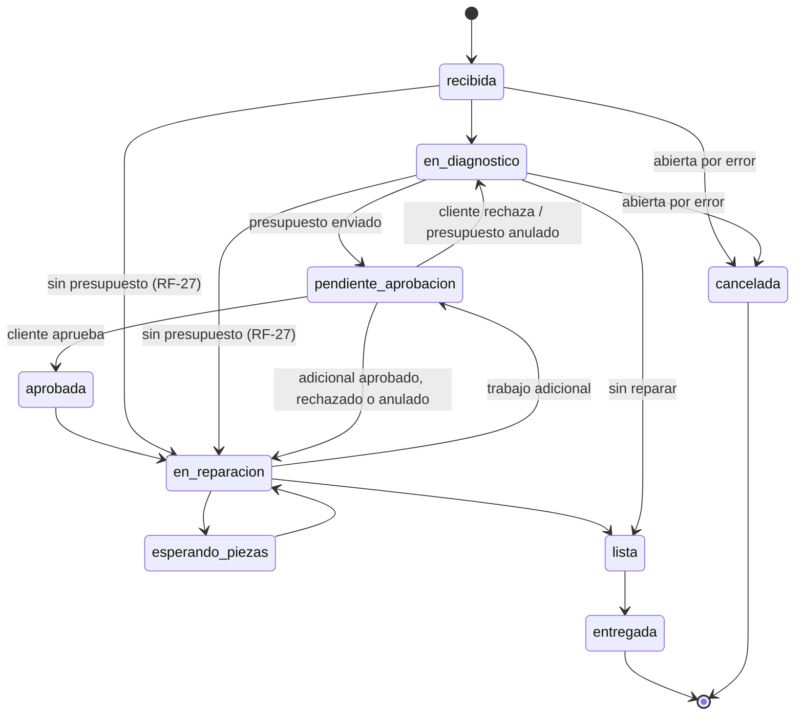
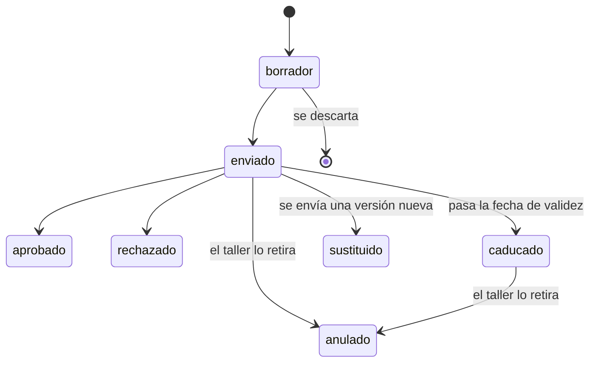
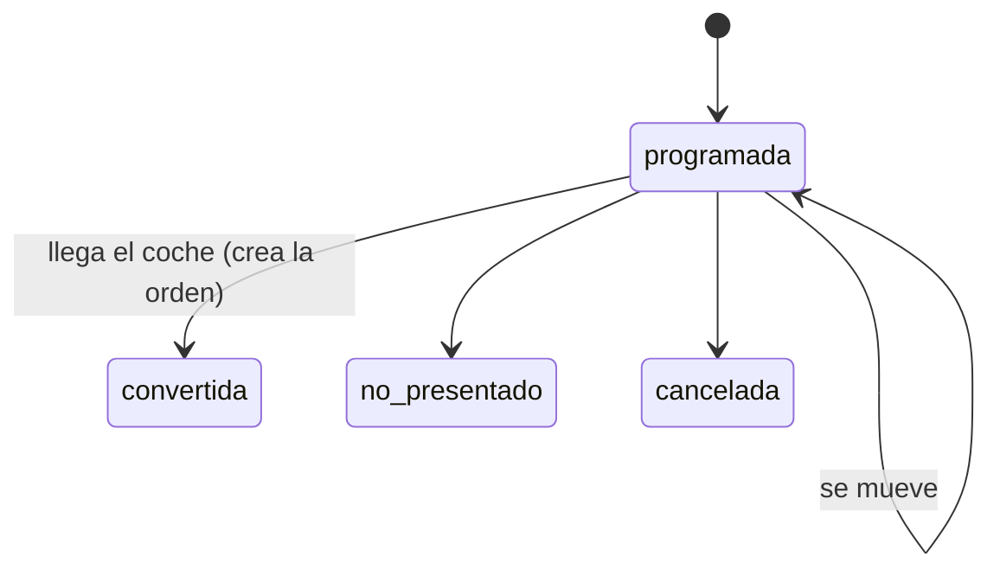

# Especificación de producto

> Estado: **v0.3, revisada completa con el usuario** (2026-10-22) · F0 a F2 construidas; lo que resultó distinto al construirlo lleva su precisión marcada con "*F1*" o "*F2*"

!!! info "Cómo leer este documento"
    Los requisitos están numerados (RF-xx funcionales, RNF-xx no funcionales) con huecos entre grupos para poder insertar sin renumerar. Lo marcado con **`[C]`** está considerado y pospuesto por ser propio de un producto comercial, no olvidado. Lo marcado con **`[?]`** es una decisión abierta que está en la sección 13.

## 0. Contexto del proyecto

**Naturaleza:** proyecto de portfolio serio, en la línea de Applications Tracker. Se construye como si fuera a usarse de verdad (los datos importan y el aislamiento entre talleres es real), pero no hay clientes de pago, contratos ni compromisos de servicio.

Calibración:

| Cajón | Qué entra |
|---|---|
| **Con rigor** | Aislamiento entre talleres (multi-tenancy), permisos comprobados en el servidor, acceso del cliente final limitado a lo suyo, ciclo de vida de la orden de trabajo con historial, presupuestos versionados e inmutables una vez enviados, prueba de la aprobación, modelo de datos, arquitectura en capas, pruebas adversas. |
| **Barato con la costura puesta** | Notificaciones (solo email, con canal preparado para WhatsApp/SMS), aprobación del presupuesto completo (con líneas preparadas para aprobación parcial), exportación de datos para facturar fuera, datos de demostración. |
| **Pospuesto `[C]`** | Facturación y Verifactu, cobro de suscripciones a los talleres, contratos de encargado de tratamiento (RGPD), administración de la plataforma más allá del alta y la baja de talleres, SLAs y guardia, analítica de uso, proveedores y pedidos de compra, reserva online de citas por el cliente. |

> **Ampliación de alcance (2026-10-22):** entran el **inventario básico** (catálogo de piezas con stock) y las **citas** (agenda interna del taller), que el primer borrador dejaba fuera. Se toma la versión barata de cada uno; lo que queda fuera de ellos está en el cajón `[C]`.
>
> **Modo de instalación y varios talleres por persona (2026-10-22):** una instalación puede servir a muchos talleres o a uno solo, y una persona puede trabajar en varios talleres independientes. Los talleres se dan de alta desde un superadministrador, sin registro abierto.

## 1. Visión

AXTTON CORE es un **sistema de gestión para talleres mecánicos** que centraliza el trabajo diario del taller (clientes, vehículos, citas, órdenes de trabajo, diagnósticos, presupuestos, piezas y documentos) y da al cliente un **portal privado** donde seguir la reparación de su vehículo, revisar y aprobar el presupuesto y consultar lo que el taller le comparte, sin tener que llamar.

> *Tu taller en orden, y tu cliente informado sin descolgar el teléfono.*

El objetivo no es sustituir un ERP desde el primer día, sino resolver muy bien un flujo: **se da cita → entra el coche → se diagnostica → se presupuesta → el cliente aprueba → se repara → se entrega.**

**Qué NO es:**

- No es un programa de facturación ni de contabilidad: llega hasta el presupuesto aprobado y los trabajos realizados. La factura se emite en el programa que ya use el taller (ver §2 y Verifactu).
- No es un sistema de compras: el inventario sabe qué piezas hay y cuántas, pero no gestiona proveedores, pedidos ni recepciones de mercancía.
- No es un sistema de reservas online ni un marketplace de talleres: las citas las anota el taller; el cliente no reserva huecos ni descubre talleres.
- No es un sistema de diagnóstico: no se conecta a la centralita del coche (OBD). El diagnóstico es lo que escribe el mecánico.
- No es un canal de chat entre taller y cliente: el portal informa y recoge decisiones, no sustituye una conversación.
- No es un sistema para cadenas de talleres: una persona puede llevar varios talleres, pero cada uno tiene sus propios clientes, catálogo y stock, y no se comparten ni se traspasan.

## 2. Decisiones tomadas

| Decisión | Valor | Implicación principal |
|---|---|---|
| Naturaleza | Portfolio serio | Rigor en el núcleo técnico; lo comercial se pospone `[C]`. |
| Organizaciones | Todo dato pertenece a un taller (multi-tenancy), siempre | Nadie ve nada de otro taller, ni sabiendo el id. Es la decisión más cara de cambiar después, por eso se toma ahora. |
| Modo de instalación | **Multi-taller** o **taller único**, elegido por configuración al desplegar | El código y el modelo de datos son los mismos en los dos modos: una instalación de taller único es una instalación con un solo taller, en la que no se pueden crear más y la interfaz oculta el selector. Pasar de único a multi-taller es cambiar la configuración; al revés solo si queda un taller. |
| Varios talleres por persona | Sí, talleres **independientes** | Un usuario puede ser empleado de varios talleres, con un rol en cada uno, y cambiar entre ellos. Los talleres no comparten clientes, catálogo ni stock; la única vista que los cruza es un resumen de cifras (RF-09). |
| Administración de la plataforma | Un **superadministrador** de la instalación | Da de alta y de baja talleres y asigna su primer administrador. **No** ve los datos operativos de los talleres (clientes, órdenes, presupuestos): administra la plataforma, no los talleres. |
| Personal del taller | Dos roles fijos: administrador y mecánico | Matriz de permisos cerrada (§3). Recepción, jefe de taller y solo lectura se valoraron y se descartaron por ahora. Toda comprobación pasa por una única función, lo que deja barato pasar a permisos configurables. |
| Empleados y usuarios | El empleado es una ficha del taller; el acceso a la aplicación es opcional | Se puede asignar a una orden un mecánico que nunca entra en la aplicación. El rol va en el empleado; el usuario solo es la forma de entrar. |
| Inventario | Catálogo de piezas con stock calculado a partir de movimientos | El stock no es un número que se edita: es la suma de entradas, salidas y ajustes, y cada uno deja rastro. Sin proveedores ni pedidos `[C]`. |
| Citas | Agenda interna del taller | El administrador anota la cita y la convierte en orden cuando llega el coche. El cliente la ve en el portal y recibe un recordatorio, pero no reserva `[C]`. |
| Nombre de la entidad central | Orden de trabajo (OT) | Vale para averías, mantenimientos y preparación de ITV, no solo reparaciones. |
| Acceso del cliente final | Enlace mágico por email, sin contraseña | El cliente no crea ni recuerda contraseñas para algo que usa dos veces al año. El email del presupuesto ya lleva un enlace de acceso. |
| Facturación | Fuera del sistema | No hay que cumplir Verifactu (obligatorio, según el calendario vigente, desde 2027). Se deja una exportación de la orden cerrada como costura. |
| Aprobación del presupuesto | Del presupuesto completo, con prueba | Se guarda qué versión exacta se aprobó, quién, cuándo, desde dónde y por qué canal. La aprobación parcial por líneas queda como costura. |
| Notificaciones | Email, mejor esfuerzo con reintentos | Presupuesto enviado y vehículo listo, como mínimo. El canal es un campo, preparado para WhatsApp o SMS. |
| Remitente de los emails | Todos salen de la plataforma, con el nombre del taller como remitente visible y su email como dirección de respuesta | Una sola configuración de correo para toda la instalación; ningún taller configura SMTP ni hay credenciales de terceros que guardar. Se valoró el correo propio de cada taller y se descartó: trae más problemas (SPF/DKIM por taller, credenciales cifradas, fallos que solo ve el taller) que ventajas. |
| Ficheros | **No hay ficheros subidos** (ni fotos, ni vídeos, ni documentos); solo documentos **generados** por el sistema a partir de los datos | Sin almacén de ficheros, cuotas de espacio ni enlaces temporales. Los PDF (presupuesto, hoja de recepción, resumen de entrega, informe de actuaciones) se generan desde datos que ya están en la base de datos. Subir ficheros queda como evolución (§12). |
| Alta de talleres | Solo el superadministrador | Sin registro abierto ni autoservicio: el primer administrador de un taller llega por invitación. Desaparece el abuso del registro como riesgo, pero el alta depende de una persona. |
| Idiomas de la interfaz | Español e inglés | Todo texto visible pasa por i18n desde el primer día, también el portal y los emails. |
| Stack de partida | El de Applications Tracker | FastAPI + PostgreSQL + React; se detalla y se justifica en la arquitectura. |
| Apps móviles | No se construyen; quizá en una fase futura (app del cliente, app del mecánico) | La web es el único cliente, pero la API se diseña como si no lo fuera: documentada, sin lógica que solo exista en el frontend y con autenticación que sirva también fuera del navegador (§12). |

## 3. Usuarios y roles

Hay **tres poblaciones de usuarios que no se mezclan**: el superadministrador, que administra la instalación; el personal del taller, que trabaja dentro de cada taller; y los clientes del taller, que solo ven el portal.

**Personas:**

- **Superadministrador.** Quien opera la instalación. Da de alta los talleres, invita a su primer administrador y puede desactivar un taller. No trabaja dentro de ningún taller ni ve sus datos.
- **Administrador del taller.** Quien lleva el taller: el dueño, el jefe de taller o quien está en el mostrador. Configura el taller y sus precios, gestiona a los empleados, atiende al cliente, abre las órdenes, prepara y envía los presupuestos, da citas, controla el stock, entrega el coche y registra el cobro. Puede ser administrador de varios talleres y verlos juntos en el resumen.
- **Mecánico.** Trabaja con el móvil o una tablet en el foso: consulta las órdenes, escribe el diagnóstico, registra los trabajos y las piezas que monta y marca la orden como lista.
- **Cliente del taller.** Particular o empresa con uno o varios vehículos. Entra en el portal desde el enlace del email, normalmente desde el móvil.

Hay **dos roles en el taller, a propósito**: en el taller pequeño al que se dirige el producto, quien atiende el mostrador es quien lo dirige. Recepción, jefe de taller o un rol de solo lectura para la gestoría se valoraron y se descartaron por ahora; añadir uno es añadir una entrada al mapa de roles (§12, permisos configurables), no tocar los endpoints.

**Matriz de permisos:**

| Acción | Administrador | Mecánico | Cliente (portal) |
|---|---|---|---|
| Configurar el taller (datos fiscales, IVA, logotipo, ajustes) | ✔ | ✘ | ✘ |
| Fijar precios: tarifas de mano de obra y precios del catálogo | ✔ | ✘ | ✘ |
| Crear fichas de empleado, darles acceso, cambiar su rol y desactivarlas (también de otros administradores) | ✔ | ✘ | ✘ |
| Crear y editar clientes y vehículos | ✔ | ✘ (solo ver) | ✘ |
| Cambiar el titular de un vehículo | ✔ | ✘ | ✘ |
| Anonimizar a un cliente que lo pide (RF-15; *fila añadida en F2*) | ✔ | ✘ | ✘ |
| Generar el informe de actuaciones de un vehículo (RF-18) | ✔ | ✘ | ✘ |
| Abrir, cancelar y entregar órdenes; asignar el mecánico responsable | ✔ | ✘ | ✘ |
| Crear, mover y cancelar citas; convertir una cita en orden | ✔ | ✘ (solo ver) | ✘ |
| Consultar el catálogo de piezas y su stock | ✔ | ✔ | ✘ |
| Registrar entradas y ajustes de stock | ✔ | ✘ | ✘ |
| Registrar las piezas usadas en una orden (salida de stock) | ✔ | ✔ | ✘ |
| Escribir diagnóstico y registrar trabajos | ✔ | ✔ | ✘ |
| Cambiar el estado de una orden (según las reglas de §6) | ✔ | Solo en reparación, esperando piezas y lista (desde en reparación) | ✘ |
| Deshacer el último cambio de estado manual | ✔ | ✘ | ✘ |
| Preparar, enviar y anular presupuestos | ✔ | ✘ | ✘ |
| Registrar una decisión recibida por teléfono o en persona | ✔ | ✘ | ✘ |
| Marcar una orden como "sin presupuesto" con su motivo | ✔ | ✘ | ✘ |
| Registrar el cobro de una orden | ✔ | ✘ | ✘ |
| Generar la hoja de recepción, recoger la firma o marcarla como firmada | ✔ | ✘ | ✘ |
| Configurar el plazo de conservación de firmas y descargar las que van a vencer | ✔ | ✘ | ✘ |
| Ver sus vehículos, sus citas, sus órdenes y su estado | — | — | ✔ (solo las suyas) |
| Aprobar o rechazar un presupuesto enviado | — | — | ✔ (solo los suyos) |
| Descargar sus documentos: presupuestos, hoja de recepción y resumen de entrega | — | — | ✔ (solo los suyos) |
| Ver importes de venta (presupuestos, piezas) | ✔ | ✔ por defecto; el taller lo puede desactivar | ✔ (solo lo suyo) |
| Ver precios de coste y márgenes | ✔ | ✘ | ✘ (nunca) |
| Ver notas internas | ✔ | ✔ | ✘ (nunca) |
| Ver el resumen de cifras de sus talleres (RF-09) | ✔ | ✘ | ✘ |
| Consultar el registro de auditoría del taller (RNF-16) | ✔ | ✘ | ✘ |
| Ver los límites del taller y lo gastado de cada uno (§10; *fila añadida en F2*) | ✔ | ✘ | ✘ |
| Ver cualquier dato de un taller en el que no es empleado | ✘ | ✘ | ✘ |

Los permisos se evalúan **en el taller activo**: quien es administrador en un taller y mecánico en otro tiene, en cada uno, los permisos de su rol allí.

El mecánico ve **todas** las órdenes del taller: en un taller pequeño todos tocan todos los coches. Su filtro "mis órdenes" muestra aquellas de las que es responsable o en las que ha registrado trabajo (RF-24, RF-25); es un filtro, no una restricción de acceso.

**Superadministrador** (fuera de la matriz porque no pertenece a ningún taller):

| Acción | Superadministrador |
|---|---|
| Dar de alta un taller e invitar a su primer administrador | ✔ (en taller único, solo si aún no existe) |
| Desactivar y reactivar un taller | ✔ |
| Ver la lista de talleres con datos de cuenta (nombre, administradores, uso respecto a los límites) y ajustar sus límites | ✔ |
| Ver clientes, vehículos, órdenes, presupuestos o documentos de un taller | ✘ (nunca) |

> Que el mecánico vea importes de venta es un ajuste del taller, no un rol distinto: la función de permisos lo consulta igual que consulta el rol. Cuando está desactivado, la API no devuelve los importes; no basta con no pintarlos.
>
> Toda fila con ✘ se comprueba en el servidor. Que la interfaz no muestre un botón no es una medida de seguridad: es una comodidad.

## 4. Modelo de dominio

```
Instalación (modo: multi-taller o taller único)
├── Superadministrador        administra talleres, no ve sus datos
└── Usuario (cuenta de acceso) ─┐
                                │ 0..n (uno por taller)
Taller (organización, el "tenant")
├── Empleado ◄──────────────────┘ ficha del personal con su rol; el usuario es opcional
├── Cliente ───────────────── particular o empresa; puede tener acceso al portal
├── Vehículo                  matrícula, VIN, marca, modelo, vencimientos
│   └── Titularidad           periodo en el que un cliente fue su titular (desde, hasta)
├── Cita                      día y hora, motivo; se convierte en orden al llegar el coche
├── Pieza                     catálogo: referencia, descripción, precio de coste y de venta
│   └── Movimiento de stock   entrada, salida o ajuste; el stock es su suma
└── Orden de trabajo          la entidad central: un vehículo y su titular en una visita al taller
    ├── Cambio de estado      cada transición del ciclo de vida, con fecha, autor y nota
    ├── Diagnóstico
    │   ├── Texto para el cliente   uno, editable, con historial de versiones
    │   └── Nota interna            hilo de entradas con autor y fecha
    ├── Presupuesto (versión 1, 2, …)
    │   ├── Línea              mano de obra, pieza u otro concepto, con cantidad, precio e IVA
    │   └── Decisión           aprobado o rechazado: quién, cuándo, canal, versión exacta
    ├── Trabajo realizado      lo que se hizo de verdad, con el empleado y horas opcionales
    ├── Pieza usada            consumo real de una pieza del catálogo (genera la salida de stock)
    └── Hoja de recepción      estado del coche al entrar, con su firma o su marca de firmada
```

- **Taller**: la unidad de aislamiento. Todo lo demás cuelga de un taller y nunca se cruza con otro.
- **Usuario**: solo una forma de entrar (email y contraseña). No tiene rol ni datos del taller.
- **Empleado**: la ficha de una persona del personal en un taller: nombre, puesto, rol, coste por hora opcional y si está activo. Puede estar ligada a un usuario o no: un mecánico que nunca toca la aplicación existe igual, es responsable de órdenes y aparece en los trabajos que registra otro por él. El rol vive en el empleado, así que una persona que trabaja en dos talleres tiene dos empleados ligados a un mismo usuario, con un rol en cada uno. Un usuario tiene como mucho un empleado por taller.
- **Taller activo**: el taller en el que trabaja la sesión en cada momento. No es un dato del usuario sino de la petición: el servidor comprueba en cada una que el usuario tiene un empleado activo en ese taller.
- **Cliente**: pertenece a un taller. Si la misma persona lleva su coche a dos talleres de la plataforma, es **un cliente distinto en cada uno**: cada taller tiene sus datos y no se comparten. Particular o empresa, tiene **un único email de acceso** (una empresa usa uno compartido). El email es opcional (hay clientes que no lo tienen o no lo dan); sin email no hay portal.
- **Vehículo**: matrícula única dentro del taller, VIN opcional, marca y modelo (texto libre con sugerencias de lo que el taller ya ha escrito), año, combustible. Guarda sus **vencimientos**: fecha de la próxima ITV y próxima revisión (por fecha, por kilómetros o por lo que llegue antes).
- **Titularidad**: el periodo en el que un cliente es el titular del vehículo **para el taller**. Es quien el taller registra como responsable del coche, que no tiene por qué coincidir con el permiso de circulación (en un renting, el taller registra a la empresa que lo usa). Un vehículo tiene en cada momento un único titular; cambiarlo cierra el periodo anterior y abre uno nuevo. Los periodos no se borran.
- **Orden de trabajo (OT)**: una visita del vehículo al taller. **Su cliente es el titular del vehículo en el momento de abrirla**, lo traiga quien lo traiga: es quien la ve en el portal, aprueba el presupuesto y paga. Quien trae o recoge el coche, si es otra persona, se anota como texto (nombre y teléfono) sin darle acceso a nada. Guarda también el mecánico responsable, kilometraje de entrada, motivo de la visita contado por el cliente, fecha prevista de entrega y estado. Lleva un número legible por taller (`OT-2026-0042`). Cambiar después el titular del vehículo no cambia el cliente de las órdenes ya abiertas.
- **Diagnóstico**: tiene dos partes con formas distintas, porque las leen personas distintas. El **texto para el cliente** es uno solo, redactado para que lo entienda alguien que no es mecánico; se edita y cada versión queda guardada con autor, y el presupuesto enviado guarda la versión que lo acompañaba. Las **notas internas** son un hilo: cada mecánico añade entradas con autor y fecha, nadie reescribe lo de otro, y nunca salen del taller.
- **Presupuesto**: cada versión es un documento cerrado. Una vez enviada, no se edita: corregirla crea la versión siguiente y la anterior queda sustituida.
- **Decisión**: la prueba de la aprobación o el rechazo. Es inmutable.
- **Hoja de recepción**: el resguardo de depósito de la visita: estado del coche al entrar (kilómetros, combustible, daños visibles, objetos) y motivo. Se considera firmada cuando el cliente firma en pantalla o cuando el administrador marca que la firmó en papel y está conforme.
- **Documentos generados**: los PDF que produce el sistema (presupuesto, hoja de recepción, resumen de entrega, informe de actuaciones). No se suben ni se editan: se generan a partir de los datos, y los que tienen valor de prueba (presupuesto enviado, hoja firmada) se generan siempre desde su versión congelada.
- **Cita**: un compromiso de que el coche vendrá un día a una hora, con un motivo. Puede ser de un cliente y vehículo ya registrados o de alguien nuevo, con solo nombre y teléfono, que se registra al llegar.
- **Pieza**: entrada del catálogo del taller. Puede tener control de stock o no (un tornillo suelto no se cuenta; una batería sí).
- **Movimiento de stock**: registro inmutable de "entraron 4", "salieron 2 para la OT-2026-0042" o "ajuste −1 por recuento". El stock de una pieza no se guarda editable: se calcula como la suma de sus movimientos.
- **Pieza usada**: lo que de verdad se montó en el coche. Es distinto de la línea del presupuesto: se presupuestan dos pastillas y se monta una, o se presupuesta una marca y se monta otra.

### Quién ve el historial de un vehículo

| Quién | Qué ve |
|---|---|
| El taller (administrador y mecánico) | Todas las órdenes del vehículo, de todos sus titulares, y puede generar el **informe de actuaciones** (RF-18) |
| El titular actual, en el portal | Las órdenes de las que fue cliente, es decir, las abiertas mientras era titular |
| Un titular anterior, en el portal | Las órdenes de su periodo, aunque el coche ya no sea suyo |
| Quien trajo el coche sin ser titular | Nada: no tiene acceso |

## 5. Requisitos funcionales

### Taller y personal (RF-01…)

- **RF-01** Los talleres los da de alta el **superadministrador** de la instalación (RF-110), que asigna su primer administrador invitándolo por email. No hay registro abierto: el personal entra siempre por invitación.
- **RF-02** Un administrador configura los datos del taller: nombre comercial, razón social, NIF, dirección, teléfono, número de inscripción en el registro industrial (obligatorio en presupuestos), logotipo, IVA por defecto y **tarifas de mano de obra** por hora con nombre (por ejemplo mecánica, electricidad, chapa y pintura), una de ellas por defecto. *Precisión al construirlo (F3 paso 1):* el logotipo es la única imagen que se sube, una excepción acotada a RF-50 ([decisión 0005](../decisiones/0005-logotipo-del-taller-como-unica-imagen-subida.md)). La zona horaria del taller la fija la plataforma. Aquí se editan también la validez del presupuesto (de 12 a 120 días hábiles, RF-33) y si el mecánico ve los importes. Cada cambio se audita con el valor anterior y el nuevo.
- **RF-03** Un administrador crea fichas de empleado con nombre, puesto, rol y, opcionalmente, coste por hora. Una ficha no necesita acceso a la aplicación.
- **RF-04** A un empleado se le puede dar acceso invitándolo por email. La invitación caduca, solo se puede usar una vez y liga el usuario que la acepta a esa ficha.
- **RF-05** Un taller tiene siempre al menos un administrador activo con acceso. No se puede desactivar, quitar el acceso ni cambiar de rol al último.
- **RF-06** Se puede cambiar el rol de un empleado, quitarle el acceso o desactivarlo. Quitar el acceso o desactivarlo surte efecto de inmediato, también en sesiones abiertas, y su nombre sigue en lo que hizo (historial, trabajos).
- **RF-07** Un mismo usuario puede trabajar en **varios talleres**, con un empleado (y un rol) distinto en cada uno. Si invitan a un email que ya tiene usuario, la invitación añade el taller a ese usuario en vez de crear otro.
- **RF-08** Quien tiene acceso a varios talleres elige con un selector en qué **taller activo** trabaja. Todo lo que ve y hace (búsquedas, listados, altas) pertenece al taller activo; cambiar de taller no mezcla nada.
- **RF-09** Un **resumen entre talleres** muestra a un usuario cifras agregadas (órdenes abiertas por estado, pendientes de cobro, citas de hoy, vehículos listos sin recoger) de los talleres en los que es administrador, con enlace a cada uno. Solo cifras y enlaces: para ver o tocar el detalle hay que entrar en el taller.

### Clientes y vehículos (RF-10…)

- **RF-10** Crear, editar, buscar y archivar clientes: nombre o razón social, NIF opcional, teléfono, email opcional, dirección, notas internas, preferencia de idioma.
- **RF-11** Crear, editar y buscar vehículos por matrícula, VIN, marca o modelo. La matrícula se normaliza (mayúsculas, sin espacios ni guiones) y es única dentro del taller. Marca y modelo son texto libre con sugerencias de lo ya escrito en el taller.
- **RF-12** Un cliente puede ser titular de varios vehículos. Cambiar el titular de un vehículo cierra el periodo de titularidad anterior y abre uno nuevo; no cambia el cliente de las órdenes ya abiertas, y desde ese momento el titular anterior no ve en el portal las órdenes nuevas ni el nuevo titular las anteriores.
- **RF-13** La ficha del vehículo muestra al taller su historial completo de órdenes, de todos sus titulares, y sus periodos de titularidad.
- **RF-14** La búsqueda principal admite matrícula, nombre o teléfono desde una única caja, porque es lo que se pregunta en el mostrador con el cliente delante.
- **RF-15** Borrar un cliente que lo pide **anonimiza** sus datos: se eliminan nombre, NIF, contacto, dirección, notas y acceso al portal, y sus órdenes, presupuestos y movimientos de stock se conservan ligados a un "cliente eliminado". Es irreversible y queda registrado quién lo hizo y cuándo. *Precisión al construirlo (F2):* no se puede con una orden abierta (aún necesita a quién avisar); también se borra quién trajo el coche en sus órdenes; sus vehículos siguen a su nombre en el historial y, para abrirles una orden, se cambia antes el titular. Lo hace solo el administrador, escribiendo el nombre del cliente para confirmar.
- **RF-16** Registrar en el vehículo la fecha de la próxima ITV y la próxima revisión, por fecha y/o kilómetros. Al entregar una orden de tipo mantenimiento, el sistema propone la siguiente revisión a partir de los intervalos que configure el taller. *F2:* los tres datos (`next_itv_date`, `next_service_date`, `next_service_km`) se registran y editan en la ficha del vehículo; la propuesta al entregar no existe aún (necesita los intervalos del taller, que no se configuran todavía), y la pantalla de vencimientos (RF-17) y sus avisos llegan en F8.
- **RF-17** Una pantalla de próximos vencimientos lista los vehículos con ITV o revisión en los próximos N días, para que el taller pueda llamar o dar cita.
- **RF-18** El taller genera en PDF un **informe de actuaciones** del vehículo con todas sus órdenes, de cualquier titular: fecha, kilómetros, texto de diagnóstico para el cliente, trabajos realizados y piezas montadas. Por defecto no incluye los nombres de titulares anteriores ni los importes, porque el informe suele acabar en manos del comprador del coche; el administrador puede incluirlos de forma explícita al generarlo.

### Órdenes de trabajo (RF-20…)

- **RF-20** Abrir una orden para un vehículo, con su **tipo** (avería, mantenimiento, ITV, garantía, chapa y pintura u otro, de una lista fija). Una orden de garantía puede enlazar a la orden original de la que viene (§6). Su cliente es el titular actual del vehículo y no se elige aparte. Si el coche lo trae otra persona, se anota su nombre y teléfono como dato de la orden, sin darle acceso. Además: motivo de la visita, kilometraje de entrada, fecha prevista de entrega y observaciones de recepción (daños visibles, objetos en el coche).
- **RF-21** Cada orden tiene un número legible, correlativo por taller y año.
- **RF-22** El diagnóstico tiene dos partes: el **texto para el cliente**, único, editable y con historial de versiones (lo que verá en el portal), y las **notas internas**, un hilo en el que cada mecánico añade entradas con autor y fecha sin poder editar las de otros, que nunca salen del taller.
- **RF-23** Registrar trabajos realizados: descripción, empleado que lo hizo (aunque lo anote otro), fecha y horas opcionales escritas a mano. No hay cronómetro de fichaje sobre la orden.
- **RF-24** Listado de órdenes abiertas filtrable por estado, mecánico responsable y fecha prevista, con las que llevan más tiempo paradas destacadas. El filtro "mis órdenes" muestra al mecánico las que tiene como responsable o en las que ha registrado trabajo.
- **RF-25** Cada orden tiene un **mecánico responsable**, que asigna y cambia el administrador (puede quedar sin asignar al abrirla). Los **mecánicos que han trabajado** en la orden no se mantienen a mano: se obtienen de los trabajos registrados (RF-23), así que la lista nunca se desincroniza de lo que se hizo.
- **RF-26** Una orden entregada o cancelada queda cerrada: solo se pueden añadir notas internas y registrar su cobro.
- **RF-27** Una orden se puede marcar como **sin presupuesto** con uno de estos motivos: el cliente **renuncia al presupuesto**, que la normativa exige por escrito y firmado por el cliente en el resguardo de depósito, así que solo se admite si la hoja de recepción lleva la renuncia y está firmada (RF-52); garantía o trabajo a precio cerrado. Queda en el historial con autor y fecha, y permite empezar a trabajar sin presupuesto aprobado. *Al construirlo (F2):* marcarla, cambiar el motivo o quitarla es una acción del administrador, solo antes de empezar la reparación, y queda en el registro de auditoría (RNF-16) con autor, fecha y el motivo anterior y el nuevo. La renuncia se rechaza hasta que exista la hoja de recepción firmada (F6).
- **RF-28** Al entregar, o después, se registra el **cobro**: cobrada o pendiente, forma de pago (efectivo, tarjeta, transferencia, otra), importe y fecha. Es una marca operativa, no una factura ni un apunte contable. *Precisión al construirlo (F2):* además de cobrada o pendiente, **sin cargo** (una garantía, un diagnóstico gratuito), para que no quede para siempre en RF-29. La fecha es el día del cobro, nunca posterior a hoy. Se puede corregir, y cada cambio queda en la auditoría.
- **RF-29** Un listado muestra las órdenes entregadas pendientes de cobro, con su importe y los días que llevan pendientes. *Precisión (F2):* el importe a cobrar sale del presupuesto aceptado, que llega en F3; hasta entonces el listado da los días pendientes, sin importe.

### Presupuestos (RF-30…)

- **RF-30** Preparar un presupuesto con líneas de tres tipos: mano de obra (horas × una de las tarifas del taller), pieza (cantidad × precio unitario) y otros. Cada línea lleva su tipo de IVA; el total desglosa base imponible por tipo de IVA, cuota de IVA y total.
- **RF-31** Un presupuesto se puede editar libremente mientras es borrador. Al **enviarlo** queda congelado. *Precisión al construirlo (F3 paso 4):* una orden tiene como mucho un borrador a la vez, y no en una orden cerrada (RF-26). Guardar reemplaza todas sus líneas y su descuento, con bloqueo optimista (RNF-15). Los totales de un borrador los calcula la API al leerlo, con la misma regla que al enviar, y no se guardan hasta enviarlo. Un borrador que nunca se envió se descarta (se borra), y su número de versión vuelve a quedar libre. El mecánico ve los presupuestos, sin importes si el taller lo ha desactivado.
- **RF-32** Corregir un presupuesto enviado crea una versión nueva; la anterior pasa a "sustituida" y ya no se puede aprobar. El cliente solo puede decidir sobre la versión vigente. *Precisión (F3 paso 4):* la versión nueva copia las líneas y el descuento de la última, nunca sus importes, que se calculan al enviar. La anterior pasa a "sustituida" al enviar la nueva (paso 5), no al crearla.
- **RF-33** Un presupuesto enviado tiene fecha de validez, **como mínimo 12 días hábiles** desde el envío, que es lo que exige la normativa; el taller puede fijar un plazo mayor, nunca menor. Pasada la fecha queda caducado y no se puede aprobar sin reenviarlo. *Precisión al construirlo (F3 paso 2, `domain/business_days.py`):* son hábiles los días de lunes a viernes que no son festivos nacionales (los de fecha fija y el Viernes Santo). No se cuentan los autonómicos, los locales ni los traslados a lunes: contar de menos solo alarga la validez, y el taller puede ampliar el plazo. El día del envío no cuenta, y se toma en la zona del taller. El presupuesto vale hasta el final del último día hábil, también en la zona del taller.
- **RF-34** El cliente aprueba o rechaza desde el portal; el rechazo admite un motivo opcional.
- **RF-35** El administrador puede registrar una decisión recibida por **teléfono o en persona**, indicando el canal y una nota. Es como se aprueba la mayoría de presupuestos en la vida real y tiene que quedar registrado, aunque como prueba vale menos que una aceptación firmada o hecha desde el portal; la interfaz lo dice al registrarla.
- **RF-36** Toda decisión guarda: versión exacta, resultado, canal (portal, teléfono, presencial), quién (cliente o el empleado que la registra), fecha y hora, y en el portal la IP y el navegador.
- **RF-37** Se genera un PDF del presupuesto, descargable por el taller y por el cliente, con lo que la normativa exige que conste: identificación del taller (nombre, NIF, domicilio y número de registro industrial), del vehículo (marca, modelo, matrícula y kilómetros), el detalle de las operaciones y piezas con sus importes, la **fecha prevista de entrega** a contar desde la aceptación, el plazo de validez y la fecha del presupuesto; y, una vez decidido, la fecha y el canal de la aceptación.
- **RF-38** Una línea de pieza se puede rellenar desde el catálogo: copia la descripción, la referencia y el precio de venta en ese momento. Cambiar después el precio del catálogo no cambia presupuestos ya hechos. Una línea de pieza **usada, reacondicionada o no específica** del modelo se marca como tal y el presupuesto lo muestra de forma visible, porque la normativa exige la conformidad previa del cliente: aprobar el presupuesto es esa conformidad.
- **RF-39** Cada línea admite un descuento en porcentaje, y el presupuesto un **descuento global** (porcentaje o importe). El global se reparte entre las líneas en proporción a su base, de modo que el desglose por tipo de IVA siga cuadrando; el céntimo que sobre del redondeo va a la línea de mayor importe. El PDF y el portal muestran el descuento global como tal, no repartido. *Precisión al construirlo (F3 paso 2, `domain/quotes.py`):* cada línea recibe la parte entera de lo que le toca. Si sobra más de un céntimo, se dan de uno en uno a las líneas con mayor parte decimal y, si empatan, a la de mayor importe. Dárselos todos a la mayor podía dejarla con una base negativa en casos extremos, y así ninguna línea recibe más que su base. El descuento de una línea se redondea sobre su importe bruto. Un descuento global en importe no puede superar la suma de las líneas.

### Portal del cliente (RF-40…)

- **RF-40** El cliente entra introduciendo su email y recibe un enlace mágico de un solo uso y corta duración. Los emails del taller (presupuesto, vehículo listo) llevan su propio enlace de acceso.
- **RF-41** Pedir un enlace para un email que no existe responde exactamente igual que para uno que existe, para no revelar quién es cliente de qué taller.
- **RF-42** El portal muestra los vehículos del cliente y sus órdenes, con el estado en un lenguaje para el cliente (§6), la fecha de la última actualización y la fecha prevista de entrega.
- **RF-43** El detalle de una orden muestra el texto de diagnóstico para el cliente, el presupuesto vigente con sus versiones anteriores, los trabajos realizados y sus documentos (RF-54). Nunca las notas internas.
- **RF-44** El cliente ve en el portal **las órdenes de las que fue cliente**, es decir, las abiertas mientras era titular del vehículo, y nada más del historial: si compra un coche de segunda mano que ya pasó por el taller, no ve las reparaciones del dueño anterior. Si necesita ese historial, se lo da el taller con el informe de actuaciones (RF-18).
- **RF-45** Si un mismo email es cliente de varios talleres, recibe **un único email con un enlace por taller**. Cada enlace abre el portal de ese taller y la sesión resultante solo ve ese taller: no existe una identidad del cliente por encima de los talleres.
- **RF-46** El portal muestra las próximas citas del cliente con su día, hora y motivo.
- **RF-47** La sesión del portal dura 30 días en el dispositivo y el cliente puede cerrarla. Anonimizar al cliente (RF-15) o cambiarle el email cierra todas sus sesiones.

### Documentos generados (RF-50…)

- **RF-50** El sistema **no admite ficheros subidos**: ni fotos, ni vídeos, ni documentos, ni en la orden ni en el vehículo. Todo documento es un PDF generado a partir de los datos registrados. *Única excepción:* el logotipo del taller (RF-02), que el servidor vuelve a dibujar antes de guardarlo ([decisión 0005](../decisiones/0005-logotipo-del-taller-como-unica-imagen-subida.md)).
- **RF-51** Al abrir la orden se genera la **hoja de recepción** (resguardo de depósito): datos del taller, cliente y vehículo, kilometraje, nivel de combustible, daños visibles, objetos en el coche, motivo de la visita, fecha, fecha prevista de entrega del presupuesto o del vehículo reparado y, si el cliente renuncia al presupuesto, la renuncia expresa ("Renuncio al presupuesto"). Se puede imprimir.
- **RF-52** La hoja de recepción queda firmada de una de dos formas: el cliente **firma en pantalla** (tablet o móvil del taller), o el administrador **marca la casilla** "firmada en papel y conforme", que registra quién la marcó y cuándo; la copia en papel la guarda el taller. Una vez firmada, la hoja queda congelada tal como estaba: si después se corrige un dato de recepción, la corrección queda en el historial de la orden y la hoja firmada no cambia.
- **RF-53** Al entregar la orden se genera el **resumen de entrega**: trabajos realizados, piezas montadas, kilometraje, fecha de entrega, el importe del presupuesto aprobado y la **garantía de la reparación**: como mínimo 3 meses o 2.000 km desde la entrega, lo que llegue antes (o el plazo mayor de una pieza, si lo tiene). El portal muestra hasta cuándo dura la garantía. Lleva escrito de forma visible **"Este documento no es una factura"**, porque se parece mucho a una.
- **RF-54** El cliente descarga en el portal, de sus órdenes, los PDF de cada versión de presupuesto enviada, la hoja de recepción y el resumen de entrega. Se generan en el momento de pedirlos y solo los ve su cliente; no hay enlaces públicos.
- **RF-55** Un mismo documento generado dos veces sale idéntico: el presupuesto, desde su versión congelada; la hoja de recepción firmada, desde su copia firmada; el resumen de entrega, desde los datos de la orden cerrada (RF-26). "Idéntico" quiere decir para el mismo estado: el PDF del presupuesto muestra si está pendiente, aprobado o rechazado, así que cambia cuando el cliente decide, y a partir de ahí vuelve a salir siempre igual.
- **RF-56** La **firma en pantalla** se conserva solo mientras puede servir de prueba: un plazo tras la entrega de la orden (por defecto 6 meses, la garantía de la reparación con margen; configurable por el taller). Al vencer se borra la imagen de la firma en todas las órdenes y la hoja queda como "firmada por el cliente el día X". Si el cliente se anonimiza antes (RF-15), la firma queda bloqueada, sin usarse para nada, hasta que vence el plazo.
- **RF-57** Antes de borrar firmas, el taller recibe un **aviso**: en la aplicación, una lista de las hojas cuya firma vence en los próximos 30 días, y un email semanal al administrador con el resumen. Desde ahí puede descargar los PDF firmados para guardarlos fuera del sistema; esas copias quedan bajo su responsabilidad. El cliente puede descargar su hoja desde el portal mientras la firma exista (RF-54).

### Notificaciones (RF-60…)

- **RF-60** Se envía un email al cliente cuando se le envía un presupuesto y cuando su vehículo está listo para recoger.
- **RF-61** El taller decide si avisa también de otros cambios de estado.
- **RF-62** Un aviso no se envía dos veces por el mismo motivo, aunque el trabajo que lo envía se reintente.
- **RF-63** Si el cliente no tiene email, la acción se completa igual y la interfaz avisa de que no se le ha notificado.
- **RF-64** Se envía un recordatorio de la cita el día anterior. Si la cita se mueve o se cancela, el recordatorio pendiente se anula o se reprograma: nunca llega uno con la fecha vieja.
- **RF-65** Se avisa al cliente por email cuando se acercan la ITV o la revisión de su vehículo (antelación configurable por taller). Solo los vencimientos **por fecha** generan aviso: los de kilómetros no, porque el sistema no sabe cuántos lleva el coche entre visitas (§8).
- **RF-66** Los avisos de vencimiento llevan un enlace para darse de baja de ellos, y el cliente también puede desactivarlos en el portal. Los avisos de su propia reparación (presupuesto, vehículo listo, cita) no se pueden desactivar: son parte del servicio.
- **RF-67** Si el vehículo cambia de titular, los avisos pendientes de vencimiento se anulan para el titular anterior.
- **RF-68** Todos los emails salen del correo de la plataforma. Los avisos al cliente llevan el nombre del taller como remitente visible ("Talleres Pérez vía AXTTON") y el email del taller como dirección de respuesta, de modo que si el cliente responde, le llega al taller.
- **RF-69** El taller ve en la orden qué avisos se enviaron al cliente y cuáles fallaron, con el motivo.

### Datos (RF-70…)

- **RF-70** Exportar una orden cerrada (cliente, vehículo, presupuesto aprobado, trabajos) en un formato que el programa de facturación del taller pueda importar `[?]` (ver R4).
- **RF-71** Exportar todos los datos del taller.
- **RF-72** Crear un taller de demostración con datos ficticios, para enseñar el proyecto sin datos reales.

### Inventario (RF-90…)

- **RF-90** Mantener un catálogo de piezas: referencia, descripción, marca, precio de coste, precio de venta, IVA y si se controla su stock.
- **RF-91** Registrar entradas de stock (llega mercancía) con cantidad, coste unitario y nota.
- **RF-92** Registrar ajustes de stock (recuento, rotura, pérdida) con cantidad positiva o negativa y motivo obligatorio.
- **RF-93** Registrar en una orden las piezas usadas. Si la pieza controla stock, genera una salida ligada a la orden. Quitar una pieza usada por error genera el movimiento contrario; nunca se borra el original.
- **RF-94** El stock de una pieza es la suma de sus movimientos. Se puede quedar en negativo (se montó una pieza cuya entrada aún no se registró), y entonces se marca como incidencia en lugar de impedir el trabajo.
- **RF-95** Cada pieza puede tener un stock mínimo; el listado destaca las que están por debajo.
- **RF-96** Ver el historial de movimientos de una pieza, con origen (entrada, ajuste o la orden que la consumió).
- **RF-97** Aprobar un presupuesto **no** mueve ni reserva stock: el stock baja cuando la pieza se monta, no cuando se promete. Como aviso, la ficha de la pieza muestra cuántas unidades aparecen en presupuestos aprobados de órdenes todavía abiertas, para que el administrador vea si dos órdenes cuentan con la misma pieza. Es un dato informativo calculado, no una reserva.

### Citas (RF-100…)

- **RF-100** Crear una cita con día, hora, duración estimada, motivo y cliente y vehículo registrados, o solo nombre, teléfono y matrícula si es alguien nuevo.
- **RF-101** Ver las citas en una vista de día y de semana, con las órdenes cuya entrega está prevista ese día.
- **RF-102** Mover o cancelar una cita, dejando constancia.
- **RF-103** Convertir una cita en orden cuando llega el coche: la orden hereda vehículo y motivo, y su cliente es el titular del vehículo. Si el cliente o el vehículo eran nuevos, se registran en ese momento (con su periodo de titularidad); si la matrícula ya existía en el taller con otro titular, el administrador decide si cambia la titularidad antes de abrir la orden.
- **RF-104** Marcar una cita como "no presentado".
- **RF-105** El sistema avisa si se solapan más citas que un número configurable por franja, pero no lo impide: la capacidad del taller la decide el administrador, no el sistema.

### Instalación y superadministrador (RF-110…)

- **RF-110** El primer superadministrador se crea con un comando en el servidor al desplegar; no hay pantalla de alta pública. Puede invitar a otros superadministradores.
- **RF-111** El modo de instalación (multi-taller o taller único) se fija por configuración. En taller único, el superadministrador crea ese taller una vez y la opción de crear más desaparece; la interfaz del taller no muestra selector ni resumen entre talleres.
- **RF-112** El superadministrador da de alta un taller con su nombre y el email de su primer administrador, que recibe una invitación (RF-04, RF-07).
- **RF-113** Desactivar un taller corta el acceso de su personal y de sus clientes al portal y detiene sus avisos, sin borrar nada. Reactivarlo lo devuelve todo como estaba.
- **RF-114** El superadministrador ve la lista de talleres con nombre, administradores (solo el nombre de los activos, sin su email), estado y uso respecto a los límites (§10), y puede ajustar los límites de un taller concreto. Nada de su contenido operativo.

### Cuenta del personal (RF-120…)

- **RF-120** El personal y el superadministrador entran con email y contraseña.
- **RF-121** Recuperar la contraseña por email con un enlace de un solo uso que caduca. Pedirlo para un email que no existe responde igual que para uno que existe.
- **RF-122** Cambiar la contraseña exige la actual y cierra las demás sesiones abiertas.
- **RF-123** Cada usuario ve sus sesiones abiertas y puede cerrar todas las demás (cerrar también la actual es cerrar sesión).
- **RF-124** Segundo factor (2FA) **pospuesto**: no se construye, pero el inicio de sesión se diseña en pasos para poder añadirlo sin rehacerlo (§12).

## 6. Ciclos de vida

### Orden de trabajo



**Reglas:**

- Las transiciones solo las valida el backend. El estado de la orden es una copia del último cambio de su historial, que es append-only, igual que en Applications Tracker.
- **Entrar en `pendiente_aprobacion` y salir de él lo provoca el presupuesto**, no un cambio manual: enviar una versión mueve la orden; la decisión del cliente o la anulación de la versión la saca. Al salir, la orden **vuelve al estado desde el que se envió**: a `en_diagnostico` si era el presupuesto inicial, a `en_reparacion` si era un trabajo adicional. Un adicional rechazado no detiene el trabajo ya aprobado.
- Si el presupuesto **caduca** (RF-33), la orden se queda en `pendiente_aprobacion` y aparece destacada en el listado. El taller envía una versión nueva o la anula. *Precisión al construirlo (F3 paso 5):* un presupuesto se envía con la orden en `en_diagnostico`, en `en_reparacion` (trabajo adicional) o en `pendiente_aprobacion` (corrigiendo la versión que espera, que pasa a sustituida). Anularlo exige un motivo, que queda en el historial de la orden. Una orden con algún presupuesto enviado ya no se cancela: si el cliente no sigue adelante, sale "lista · sin reparar". Hasta el trabajo en segundo plano (F5), la caducidad se calcula por la fecha de validez y nadie la marca: la interfaz la enseña igual. Para ampliar el plazo de una versión enviada, caducada o no, se **renueva**: se envía en un solo paso una versión nueva con las mismas líneas, precios y descuento y una validez nueva desde ese día, y la renovada queda sustituida tal como se envió. Su fecha no se cambia nunca: es parte de lo que el cliente recibió (invariante 6).
- No se puede pasar a `en_reparacion` sin un presupuesto aprobado, salvo que la orden esté marcada como "sin presupuesto" con su motivo (RF-27). En ese caso puede ir de `recibida` o `en_diagnostico` directamente a `en_reparacion`.
- **Sin reparar.** Si el cliente rechaza el presupuesto y se lleva el coche, o el diagnóstico no encuentra nada que reparar, la orden pasa de `en_diagnostico` a `lista` marcada como **sin reparar**, y de ahí a `entregada`, con su cobro si se cobra el diagnóstico. El coche siempre sale del taller por `entregada`.
- **`cancelada` es solo para órdenes abiertas por error**: sin trabajos registrados, sin piezas usadas y sin presupuestos enviados. Exige un motivo y no aparece en el portal del cliente.
- El cobro (RF-28) no es un estado: una orden `entregada` puede estar cobrada o pendiente, y eso no cambia su ciclo de vida.
- **Una orden entregada no se reabre nunca.** Si el coche vuelve con el mismo problema, se abre una orden nueva de tipo garantía enlazada a la original; la original conserva intactos sus presupuestos, su cobro y sus documentos.
- **Deshacer.** El administrador puede deshacer el **último cambio de estado hecho a mano**: se registra un cambio compensatorio en el historial, nunca se borra el original. No se pueden deshacer los cambios provocados por el presupuesto o por la decisión del cliente, ni uno que ya envió un aviso al cliente (deshacer un "lista" no puede desenviar el email). *Precisado al construirlo (F2):* tampoco se deshace un cambio que **cerró** la orden (`entregada` o `cancelada`), porque una orden entregada no se reabre nunca; ni un deshacer, porque no hay "rehacer": se vuelve a hacer el cambio.

**Quién mueve cada estado.** El mecánico pasa la orden a `en_reparacion`, `esperando_piezas` y `lista` (solo desde `en_reparacion`). Todo lo demás, incluidos "sin reparar", `entregada`, `cancelada` y deshacer, lo hace el administrador.

**Lo que ve el cliente.** El portal no enseña los estados internos tal cual:

| Estado interno | Lo que ve el cliente |
|---|---|
| recibida, en_diagnostico | En revisión |
| pendiente_aprobacion | Presupuesto pendiente de tu respuesta |
| aprobada, en_reparacion | En reparación |
| esperando_piezas | En reparación · esperando piezas |
| lista | Listo para recoger |
| lista (sin reparar) | Listo para recoger · sin reparar |
| entregada | Entregado |
| cancelada | No aparece |

"Esperando piezas" se muestra como subestado de "En reparación": explica un retraso antes de que el cliente llame, que es justo lo que el portal quiere evitar.

### Presupuesto (cada versión)



Solo una versión puede estar en `enviado` a la vez por orden. Aprobado, rechazado, sustituido y anulado son finales; un presupuesto caducado solo se puede anular o sustituir por una versión nueva. Anular exige un motivo y avisa al cliente si ya lo había recibido.

### Cita



Convertida, no presentado y cancelada son finales. Una cita convertida apunta a su orden. Si un cliente que no se presentó vuelve a pedir cita, es una cita nueva.

## 7. Matriz de documentos

No hay ficheros subidos (RF-50). Todo lo que sale del sistema es un documento generado:

| Documento | Cuándo se genera | De qué datos sale | Quién lo ve | Fase |
|---|---|---|---|---|
| Presupuesto (PDF) | Al enviar cada versión | La versión congelada | Taller y cliente | F3 |
| Hoja de recepción (PDF) | Al abrir la orden | Los datos de recepción; tras firmarla, su copia congelada con la firma | Taller y cliente | F6 |
| Resumen de entrega (PDF) | Al entregar | La orden cerrada: trabajos, piezas, presupuesto aprobado | Taller y cliente | F6 |
| Informe de actuaciones (PDF) | Cuando lo pide el taller | Todas las órdenes del vehículo (RF-18) | Solo el taller, que decide a quién se lo da | F6 |
| Exportaciones (CSV) | Cuando lo pide el taller | Órdenes cerradas y datos del taller (RF-70, RF-71) | Solo el taller | F9 |

Fuera de esta versión: fotos, vídeos y documentos subidos, en la orden o en el vehículo (§12).

## 8. Límite conocido

El sistema **solo sabe lo que el taller registra**. El portal es tan fiel como el último cambio que hizo alguien en el taller.

| Responde bien | No responde bien |
|---|---|
| "¿En qué estado está mi coche según el taller?" | "¿Cuándo estará *de verdad*?": la fecha prevista es la que escribe el taller, no una estimación |
| "¿Qué presupuesto aprobé y cuándo?" | "¿Por qué tardan?", si el taller no ha actualizado el estado |
| "¿Qué trabajos se hicieron?" | "¿Este precio es justo?": no compara con otros talleres |
| "¿Dónde está mi presupuesto o mi hoja de recepción?" | "¿Qué le pasa a mi coche?" más allá de lo que escribió el mecánico |
| "¿Cuándo me toca la ITV?", según la fecha registrada | "¿Me toca ya la revisión de los 30.000 km?": solo conoce los kilómetros de la última visita |
| "¿Cuántas baterías me quedan?", si se registran las entradas | El stock real si se monta una pieza sin registrarla o llega mercancía sin darle entrada: el sistema sabe lo registrado, no lo que hay en la estantería. Por eso el stock negativo se marca como incidencia (RF-94) |
| "¿Qué órdenes tengo pendientes de cobro?" | "¿Cuánto he facturado este trimestre?": el cobro es una marca operativa, no contabilidad (RF-28) |
| "¿Qué se le hizo a este coche en este taller?" (RF-18) | "¿Qué se le ha hecho a este coche en su vida?": solo conoce lo que pasó por este taller |

**RF-80** Para que el cliente no lea un estado viejo como si fuera actual, el portal muestra siempre **cuándo se actualizó por última vez**, y si la fecha prevista de entrega ha pasado sin que la orden esté lista, lo dice ("La fecha prevista era el 14 de octubre; el taller aún no la ha actualizado") en lugar de seguir mostrándola como si fuera válida.

## 9. Requisitos no funcionales

### Seguridad y aislamiento

- **RNF-01** Aislamiento entre talleres en **dos capas**: la aplicación filtra siempre por el taller de la sesión y la base de datos impide enlazar datos de dos talleres. Un recurso de otro taller responde igual que uno inexistente (404, nunca 403).
- **RNF-02** El acceso del cliente se comprueba en el servidor en cada petición, por la relación de la orden con el cliente, no por el vehículo (RF-44).
- **RNF-03** Las comprobaciones de permisos pasan por una única función por tipo de actor (personal y cliente). Ningún endpoint decide permisos por su cuenta.
- **RNF-04** Los enlaces mágicos son de un solo uso, caducan en minutos y no se pueden reutilizar desde otro dispositivo después de usarse.
- **RNF-05** Los ids que aparecen en las URL del portal no son correlativos.
- **RNF-06** Límite de peticiones en las invitaciones, el inicio de sesión, la recuperación de contraseña y la petición de enlaces mágicos (§10).
- **RNF-07** Hay pruebas automáticas que intentan leer y escribir datos de otro taller y de otro cliente por cada endpoint, y fallan si alguno lo consigue.
- **RNF-08** El superadministrador no tiene acceso a los datos operativos de los talleres por la API: sus endpoints son otros y no pasan por la función de permisos del taller.
- **RNF-09** El taller activo llega en cada petición y el servidor lo valida contra los empleados activos del usuario; nunca se confía en él solo porque lo envíe el cliente. El resumen entre talleres (RF-09) es **la única consulta que cruza talleres**: recibe el conjunto explícito de talleres en los que el usuario es administrador, devuelve solo cifras y tiene sus propias pruebas adversas (un mecánico en un taller y administrador en otro no ve cifras del primero).

### Integridad

- **RNF-10** Los importes se guardan como enteros en céntimos; nunca como coma flotante.
- **RNF-11** Una versión de presupuesto enviada, una decisión y una hoja de recepción firmada no se modifican jamás, ni siquiera desde la base de datos por la aplicación. El total de una versión enviada se guarda, no se recalcula.
- **RNF-12** Los cambios de estado, las decisiones y los movimientos de stock son append-only. Un error se corrige con un movimiento contrario, nunca editando o borrando.
- **RNF-13** Dos personas registrando a la vez una salida de la misma pieza no pueden perder ninguna de las dos: el stock se calcula, no se lee, se resta y se escribe.
- **RNF-14** Los totales se calculan con una única regla de redondeo, escrita y probada: por línea, y luego se suma. El total que ve el cliente en el portal, el del PDF y el de la exportación son el mismo número guardado, no tres cálculos.
- **RNF-15** Si dos personas editan a la vez lo mismo (una orden, un borrador de presupuesto, el texto de diagnóstico), la segunda en guardar recibe un aviso de que ha cambiado y decide; nunca se pisa en silencio lo que guardó la primera.
- **RNF-16** Un **registro de auditoría** append-only guarda las acciones sensibles con autor, fecha y, cuando aplica, el valor anterior y el nuevo: cambios de precios y tarifas, altas, cambios de rol y desactivaciones de empleados, cambios de titular, anonimizaciones, firmas y marcas de firmada, deshacer un estado, informes de actuaciones con datos personales (RF-18) y alta, desactivación y cambio de límites de talleres. El administrador consulta el de su taller; el superadministrador, el de la plataforma.

### Rendimiento

Medido en el servidor con un taller de **50.000 órdenes, 20.000 vehículos y 5.000 piezas** (unos diez años de un taller mediano):

- **RNF-50** Listados, fichas y guardados responden en menos de **300 ms** en el percentil 95.
- **RNF-51** La búsqueda principal (RF-14) responde en menos de **500 ms** en el percentil 95.
- **RNF-52** Un PDF se genera en menos de **3 s**; el informe de actuaciones de un vehículo con 100 órdenes, en menos de 10 s.
- **RNF-53** El portal carga en un móvil con 4G en menos de **2,5 s** hasta mostrar el estado de la orden.

### Usabilidad

- **RNF-20** La interfaz del taller es usable en el móvil del mecánico (diagnóstico, trabajos, piezas) y el portal está pensado primero para el móvil.
- **RNF-21** Abrir una orden para un cliente y vehículo ya registrados lleva menos de un minuto.
- **RNF-22** La aplicación funciona **solo con conexión**, pero no pierde lo escrito: lo que el mecánico está escribiendo (diagnóstico, nota, trabajo) se guarda como borrador en el dispositivo y se envía al recuperar la conexión, con el mismo aviso de RNF-15 si algo cambió entretanto. La interfaz muestra claramente cuándo no hay conexión y qué está pendiente de enviar. *Precisión al construirlo (F2):* lo pendiente se envía solo si la orden está abierta en pantalla al volver la conexión, o al volver a abrirla; desde la cabecera se llega a cada orden con algo pendiente. Los borradores no salen del dispositivo: si se cambia de dispositivo, no siguen a la persona.
- **RNF-23** Accesibilidad: se puede usar con teclado, con contraste suficiente y con etiquetas en todos los controles (criterios de nivel AA de WCAG 2.2 como referencia), con especial cuidado en el portal, que usa cualquiera.
- **RNF-24** Navegadores soportados: las dos últimas versiones de Chrome, Edge, Firefox y Safari (también en iOS).

### Calidad y operación

- **RNF-30** Desarrollo con un único comando (Docker Compose), como en Applications Tracker.
- **RNF-31** CI con pruebas de backend, frontend y aislamiento en cada push.
- **RNF-32** Sin servidor de correo configurado la aplicación arranca igual y lo que depende del email se muestra como no disponible.
- **RNF-33** **Copias de seguridad diarias** de la base de datos, guardadas fuera del servidor y conservadas 30 días. Antes de dar por cerrada la puesta en producción se restaura una copia en un entorno limpio y se comprueba que funciona: una copia que nunca se ha restaurado no cuenta.
- **RNF-34** Los logs son estructurados, llevan el taller y la petición, y no contienen datos personales de clientes (ni emails, ni nombres, ni matrículas) ni secretos.
- **RNF-35** Las migraciones de base de datos se aplican sin perder datos y se prueban en CI contra una base con datos.

### Cumplimiento

- **RNF-40** Los datos de clientes son personales: el taller puede exportarlos y borrar un cliente que lo pida, anonimizándolo (RF-15). Tras anonimizar no queda el dato personal en ninguna tabla de la aplicación, incluidos los historiales y los avisos pendientes (las firmas, solo hasta que vence su plazo, RF-56); las copias de seguridad lo conservan hasta que caducan.
- **RNF-41** Contrato de encargado de tratamiento entre plataforma y taller, textos legales completos `[C]`.

## 10. Límites y cuotas

Existen desde el primer día, aunque no se cobre por ellos. Los de cuenta los puede ajustar el superadministrador por taller (RF-114).

*Precisión antes del primer despliegue (F2):* los límites de cuenta de un taller nacen con los del **plan básico**, pensado para un taller pequeño (de 1 a 5 mecánicos y unas 5 a 8 órdenes al día), y el superadministrador los ajusta taller a taller; su administrador ve lo gastado de cada uno en su cuenta. Al llegar a uno, el alta se rechaza con un mensaje que dice cuál; bajarlo por debajo de lo gastado no borra nada. Los **planes con nombre** (básico, profesional…) quedan para cuando haya facturación (`[C]`): estos valores serán entonces los del básico. La demo pública usa unos más bajos (200 clientes, 300 vehículos, 100 órdenes al mes).

| Límite de cuenta (plan básico) | Valor inicial | Motivo |
|---|---|---|
| Empleados con acceso por taller | 5 | Las fichas sin acceso no cuentan. *Era 20 hasta fijar el plan básico* |
| Fichas de empleado activas, con o sin acceso | 10 | Un mecánico que no entra también cuenta |
| Clientes | 1.000 | Acumulados: un archivado o anonimizado ocupa su fila. Si archivar liberase hueco, serviría para saltarse el límite |
| Vehículos | 1.500 | Algo más que clientes: hay quien tiene varios |
| Órdenes al mes (del taller) | 200 | Las órdenes se acumulan sin fin; 200 da margen a un taller que hace unas 150 |

| Otros límites | Valor inicial | Motivo |
|---|---|---|
| Piezas en el catálogo | 10.000 | Un catálogo básico; más indica una importación masiva que no está soportada |
| Líneas por versión de presupuesto | 200 | Un presupuesto de taller no tiene más; protege el PDF y el cálculo de totales |
| Versiones de presupuesto por orden | 20 | Más indica un uso anómalo |
| Intentos de inicio de sesión | 10 por hora por email y 30 por minuto por IP | Frenar el ataque por fuerza bruta sin bloquear al usuario legítimo: se frena, nunca se bloquea la cuenta. *Al construirlo en F1 se fijó por hora y se añadió la IP, holgada porque el personal de un taller comparte la suya* |
| Recuperaciones de contraseña | 3 por hora por email y 10 por hora por IP | Evitar usar el sistema para enviar spam. *Fijado en F1, más estricto que el 5 inicial* |
| Enlaces mágicos por email y hora | 5 | Ídem. Llega con el portal (F4) |
| Validez de un enlace mágico | 15 minutos | Equilibrio entre seguridad y que el cliente abra el correo tarde |
| Validez de una invitación | 7 días | El invitado puede tardar en verla; después hay que reenviarla |
| Sesión del portal | 30 días | RF-47 |
| Conservación de la firma en pantalla | 6 meses tras la entrega, configurable | Mientras puede servir de prueba (RF-56) |
| Validez del presupuesto | 12 días hábiles como mínimo; el taller puede ampliarla | Mínimo legal (RD 1457/1986, ver R5) |

## 11. Alcance por fases

Cada fase se define por lo que reduce de riesgo o lo que enseña, no por lo que vende.

| Fase | Contenido | Riesgo que reduce |
|---|---|---|
| **F0** | **Esqueleto vertical desechable:** un taller fijo, crear cliente + vehículo + orden, un presupuesto de una línea, enlace secreto sin autenticación donde el cliente aprueba, y el estado de la orden cambia. Feo y sin roles. | Descubrir dónde están las dificultades reales (congelar presupuestos, el paso entre dos tipos de usuario) antes de construir encima. |
| **F1** | Autenticación del personal (inicio de sesión, recuperación y cambio de contraseña, sesiones), envío de emails básico, superadministrador y alta de talleres, modo de instalación, roles e invitaciones, varios talleres por usuario con taller activo, registro de auditoría, **aislamiento entre talleres** con sus pruebas adversas y **CI** que las ejecuta en cada push. | Lo más caro de añadir tarde. Sin esto, todo lo demás se construye sobre un supuesto. |
| **F2** | Clientes, vehículos con titularidad y órdenes con su ciclo de vida, historial, búsqueda, edición concurrente sin pisarse y borradores sin conexión. **Primer despliegue en Coolify**: desde aquí, cada fase termina en producción. | El núcleo operativo del taller, y descubrir pronto los problemas de desplegar. |
| **F3** | Datos del taller y tarifas de mano de obra editables por su administrador (RF-02), presupuestos versionados, envío, decisión registrada por el taller y PDF del presupuesto. | La parte con más reglas e integridad. |
| **F4** | Portal del cliente con enlace mágico, aprobación desde el portal y estados para el cliente. | La segunda población de usuarios y su aislamiento. |
| **F5** | Trabajo en segundo plano y avisos al cliente (presupuesto enviado, vehículo listo), con reintentos y sin duplicados. Hasta F5, los emails de acceso (invitaciones, enlaces mágicos) se envían en la propia petición. | Envíos idempotentes y fallos de un tercero. |
| **F6** | Documentos generados: hoja de recepción con firma en pantalla o marca de firmada, resumen de entrega, informe de actuaciones y su descarga en el portal. | Documentos con valor de prueba que no pueden cambiar después de firmados o enviados. |
| **F7** | Inventario: catálogo, movimientos de stock, piezas usadas en la orden y líneas de presupuesto desde el catálogo. | Integridad bajo concurrencia y un libro de movimientos append-only. |
| **F8** | Citas y vencimientos: agenda, conversión en orden, recordatorio de cita, ITV y revisiones con sus avisos y la baja de los avisos, y el borrado programado de firmas vencidas con su aviso previo. *Añadido en F3:* el **calendario del taller**, con su horario, sus festivos autonómicos y locales y sus días de cierre (vacaciones). Lo usan las citas, los recordatorios y las órdenes paradas (RF-24), y los festivos también la validez del presupuesto (RF-33), que hasta entonces solo descuenta los nacionales. | Trabajos programados, zonas horarias y avisos que hay que anular cuando cambia lo que avisaban. |
| **F9** | Resumen entre talleres, exportaciones, revisión final, datos de demostración y copias de seguridad con restauración probada. | Que se pueda enseñar y que los datos sobrevivan a un desastre. |

**Evolución documentada que no se construye en esta versión:** gastos de estancia del vehículo (la normativa los permite si el cliente no responde en 3 días tras el aviso), fotos, vídeos y documentos subidos (en la orden y en el vehículo), segundo factor (2FA), apps móviles del cliente y del mecánico, aprobación parcial por líneas, avisos por WhatsApp, reserva de citas por el cliente, proveedores y pedidos de compra, catálogo de mano de obra (tiempos estándar), facturación con Verifactu, permisos configurables, talleres de una misma empresa que comparten clientes o stock.

## 12. Puntos de extensión

Solo se deja una costura si es barata. Si prepararse para el futuro cuesta trabajo real, no se hace y se apunta como riesgo.

| Funcionalidad futura | Costura que se deja puesta hoy |
|---|---|
| Aprobación parcial por líneas | La decisión se guarda con referencia a la versión; las líneas tienen id propio y un campo `optional` sin usar. |
| WhatsApp / SMS | Cada aviso tiene un `channel`; el envío pasa por una interfaz con una implementación de email. |
| Varios contactos por cliente empresa | El acceso al portal se resuelve desde una función que hoy devuelve el email del cliente; mañana devolvería sus contactos. |
| Permisos configurables | Una única función `can(actor, acción, recurso)`; los roles son un mapa de acciones, no `if` repartidos. |
| Talleres de una misma empresa (sedes) | **Sin costura**: compartir clientes o stock entre talleres cambiaría la unidad de aislamiento, y prepararlo no es barato. Se registra como riesgo (R13). |
| Facturación propia | La orden cerrada se puede exportar; los importes y el IVA ya están por línea y en céntimos. |
| Proveedores y pedidos | Cada movimiento de stock tiene un tipo y una referencia a su origen; un pedido recibido sería un origen más. |
| Reserva de citas por el cliente | La cita tiene un campo `source` (taller, y en el futuro portal); la conversión en orden no depende de quién la creó. |
| Catálogo de mano de obra | Las líneas guardan su descripción y precio copiados, no una referencia a un catálogo que pueda cambiar (ya ocurre con las piezas, RF-38). |
| Fotos, vídeos y documentos subidos | Los documentos se sirven siempre por un endpoint que comprueba el permiso sobre la orden o el vehículo, nunca por una URL directa: un fichero subido sería otro tipo de documento por el mismo camino. Añadirlo después cuesta lo mismo que ahora (un servicio de almacenamiento, subida, cuota y copias de seguridad) y no obliga a rehacer nada. |
| Segundo factor (2FA) | El inicio de sesión es un flujo en pasos (credenciales, y después la sesión), no una única llamada que devuelve la sesión: un paso intermedio de código encaja sin cambiar a los clientes de la API. |
| API para integraciones | La lógica vive en servicios, no en los endpoints. |
| App móvil del cliente o del mecánico | La API es la única puerta: ninguna regla (transiciones, permisos, totales) vive solo en el frontend. Las rutas del portal y las del taller están separadas y documentadas en OpenAPI, y la autenticación acepta, además de la cookie del navegador, un token Bearer, como ya hace Applications Tracker. |

## 13. Riesgos y decisiones abiertas

| # | Riesgo o pregunta | Impacto | Cuándo decidir |
|---|---|---|---|
| R1 | **Sobreingeniería y alcance**: multi-tenancy con dos modos de instalación, tres tipos de usuario, versionado, inventario y citas ya son nueve fases. La tentación de añadir proveedores, reservas online o facturación hará que no se acabe nunca. | Alto | Siempre: cualquier cosa fuera de §1 pasa por la bitácora de decisiones. |
| R2 | Cómo autenticar tres poblaciones (superadministrador y personal con contraseña, clientes con enlace mágico) sin que una sesión de cliente llegue a la API del taller ni una de superadministrador a los datos de un taller. | Alto | **Resuelto (2026-10-22):** SuperTokens para los tres actores, con el actor en la sesión y tres prefijos de API cerrados entre sí ([arquitectura](../arquitectura/index.md) A4, A5) |
| R3 | Un mismo email cliente de varios talleres: ¿un enlace por taller, o un selector tras entrar? | Medio | **Resuelto (2026-10-22):** un enlace por taller en un único email (RF-45) |
| R4 | Formato de exportación hacia programas de facturación: CSV genérico o alguno concreto. | Bajo | F9 |
| R5 | Normativa de talleres en España (presupuesto por escrito, plazo de validez, resguardo de depósito, renuncia al presupuesto): confirmar qué exige para que el flujo sea realista. | Medio | **Resuelto (2026-10-22):** RD 1457/1986, modificado por el RD 455/2010. Se incorporan la validez mínima de 12 días hábiles (RF-33), el contenido del presupuesto (RF-37), la conformidad para piezas usadas (RF-38), la renuncia firmada en el resguardo (RF-27, RF-51) y la garantía de 3 meses o 2.000 km (RF-53). Algunas comunidades autónomas tienen normativa propia que puede añadir requisitos; no se ha revisado. Fuentes en la bitácora de decisiones cuando exista. |
| R6 | ¿Ve el cliente "esperando piezas" o solo "en reparación"? | Bajo | **Resuelto (2026-10-22):** sí, como subestado |
| R7 | Borrado de un cliente con órdenes que el taller debe conservar: anonimizar vs conservar. | Medio | **Resuelto (2026-10-22):** anonimizar (RF-15) |
| R8 | ¿Ve el mecánico los precios del presupuesto? | Bajo | **Resuelto (2026-10-22):** ve los de venta salvo que el taller lo desactive; nunca los de coste |
| R9 | Qué cambia en el stack respecto a Applications Tracker (proveedor de autenticación, generador de PDF; ya no hace falta almacén de ficheros). | Medio | **Resuelto (2026-10-22):** ver [arquitectura](../arquitectura/index.md) §1 |
| R10 | Zona horaria: un taller tiene la suya y las citas y recordatorios dependen de ella. ¿Se guarda por taller desde F1 aunque todos estén en España? | Medio | **Resuelto (2026-10-22):** sí, zona horaria por taller desde F1; las fechas se guardan en UTC y se muestran en la del taller |
| R11 | ¿Debe un presupuesto aprobado **reservar** las piezas (para que otra orden no las use) o basta con descontarlas al montarlas? | Medio | **Resuelto (2026-10-22):** se descuentan al montar, con aviso informativo de unidades comprometidas (RF-97) |
| R12 | ¿Correo propio de cada taller o de la plataforma? | Medio | **Resuelto (2026-10-22):** de la plataforma, con el nombre y la respuesta del taller (RF-68); el correo propio se descartó por coste |
| R13 | Si algún día varios talleres de un mismo dueño quieren compartir clientes o catálogo, el diseño actual no lo soporta: la unidad de aislamiento es el taller. Se acepta a sabiendas. | Medio | Solo si aparece la necesidad; sería una decisión en la bitácora |
| R14 | La firma en pantalla es un dato personal. Al anonimizar a un cliente (RF-15), ¿se borra la firma de sus hojas de recepción (se pierde la prueba) o se conserva como excepción justificada? | Medio | **Resuelto (2026-10-22):** se conserva un plazo tras la entrega (6 meses por defecto) y después se borra en todas las órdenes, con aviso previo al taller para que pueda descargarla (RF-56, RF-57) |

## 14. Criterios de éxito

- El flujo completo (cita → entra el coche con su hoja de recepción firmada → presupuesto → aprobación desde el móvil del cliente → reparación → listo → entregado con su resumen y su garantía) funciona de punta a punta en producción con datos de demostración.
- Las pruebas adversas demuestran que ningún endpoint deja leer ni escribir datos de otro taller ni de otro cliente, y que el superadministrador no llega a los datos de ningún taller.
- Se puede demostrar, para cualquier orden, qué versión de presupuesto se aprobó, quién, cuándo y por qué canal, y que el PDF que se descarga hoy es idéntico al que se envió.
- Los objetivos de rendimiento (RNF-50 a RNF-53) se cumplen con el volumen de datos de referencia.
- Una copia de seguridad de producción se ha restaurado en un entorno limpio y funciona.
- Alguien de fuera entiende el proyecto en dos minutos desde el README y lo arranca con un comando.
